# Kratos MDPA Preview (VS Code extension)

[](https://marketplace.visualstudio.com/items?itemName=kratos-multiphysics.vscode-mdpa) [](https://marketplace.visualstudio.com/items?itemName=kratos-multiphysics.vscode-mdpa) [](https://github.com/loumalouomega/VSCode-MDPA-Preview/releases) [](LICENSE) [](https://github.com/loumalouomega/VSCode-MDPA-Preview/actions) [](https://loumalouomega.github.io/VSCode-MDPA-Preview/)

📖 **[Read the full documentation »](https://loumalouomega.github.io/VSCode-MDPA-Preview/)**

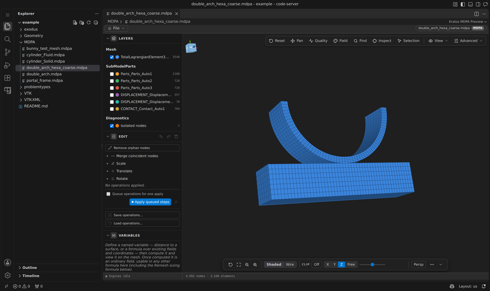

Preview, organize, edit, and remesh Kratos Multiphysics `.mdpa` model-part files directly in VS Code: a 3D mesh viewer with a navigable **ModelPart / SubModelPart outline** whose entries are **toggleable layers**.

It is fully self-contained — a pure-TypeScript parser feeds a [VTK.js](https://kitware.github.io/vtk-js/) viewer running in a webview. **No Python or compiled Kratos is required.**

<details>
<summary>More screenshots</summary>

| Mesh quality | Field contour |
|---|---|
| 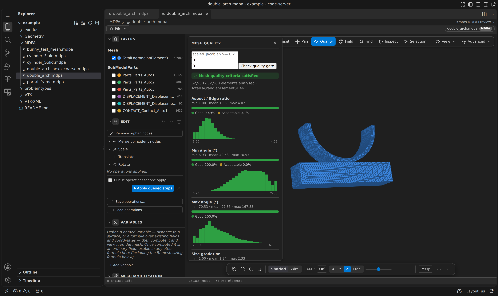 | 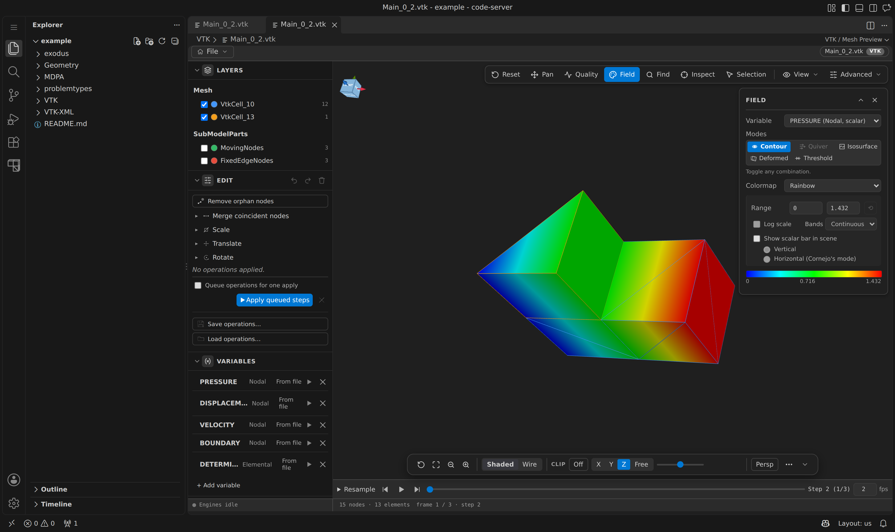 |
| **Level-set split (MMG)** | **Linear → Quadratic** |
| 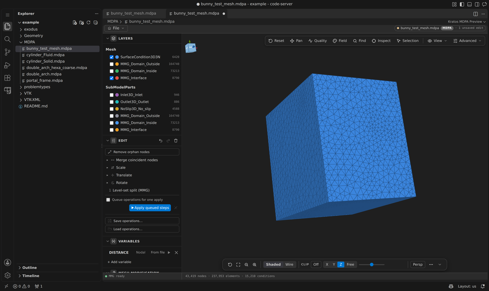 | 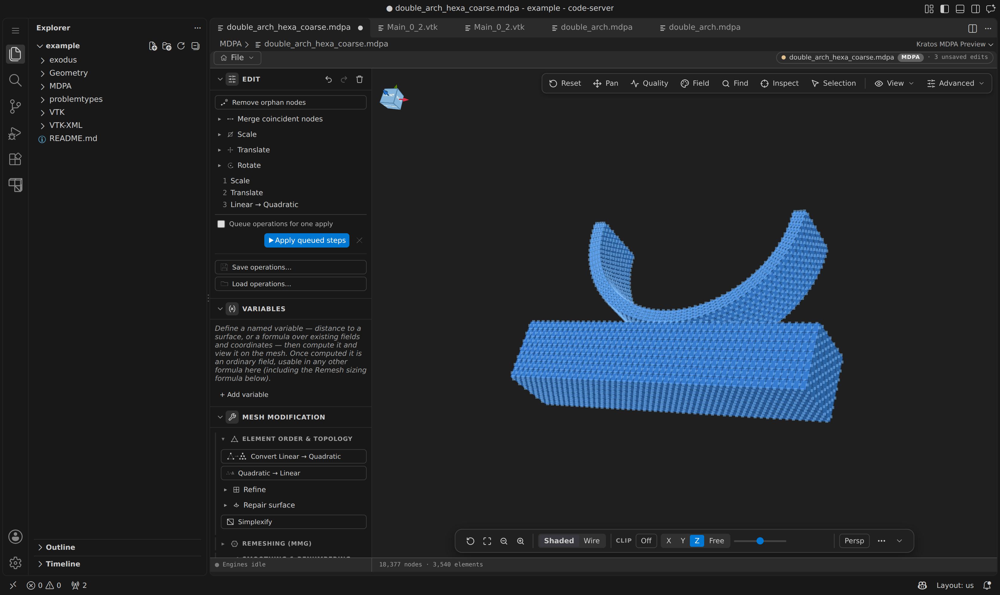 |
| **Problemtype: build & run Kratos cases** | **Sphere / particle elements** (Advanced menu) |
| 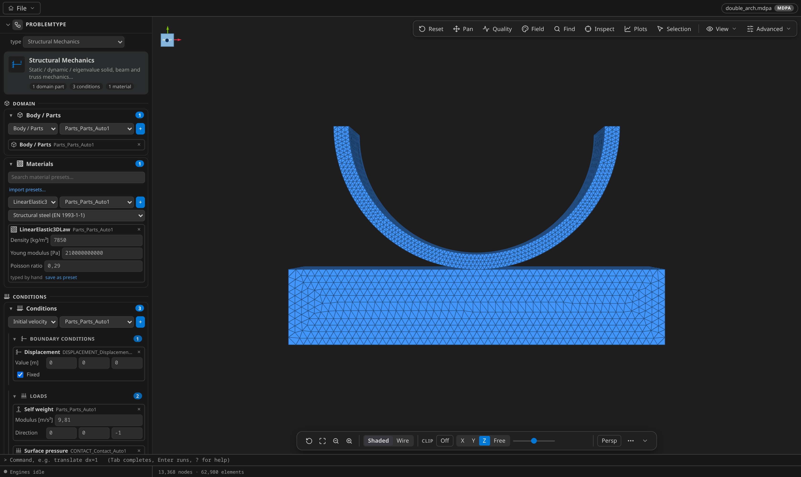 | 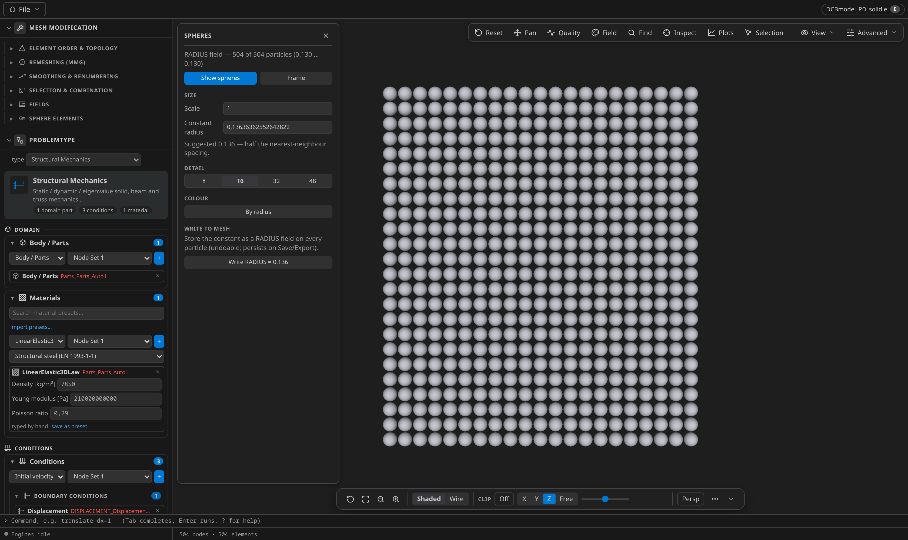 |
| **Additional mesh operations** | **Face normals** (Advanced menu) |
| 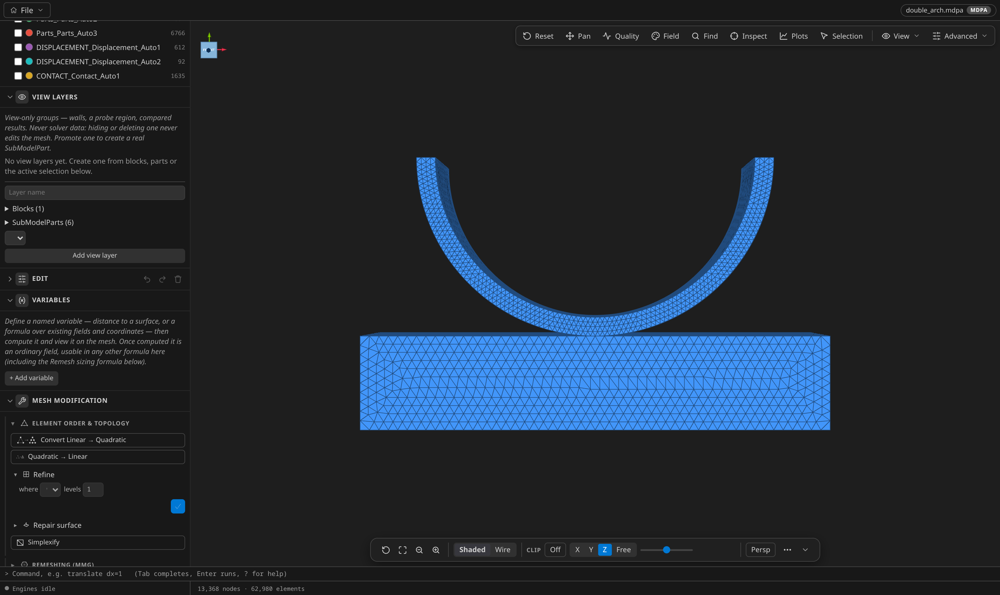 | 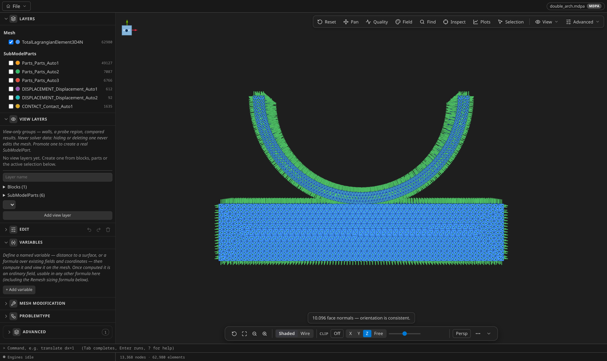 |

</details>

> 📖 See the [full documentation](https://loumalouomega.github.io/VSCode-MDPA-Preview/) for a screenshot-rich walkthrough of every feature.

## Features

- **Preview and navigate** — open a mesh from the Kratos activity-bar sidebar and explore nodes, elements, conditions, geometries, and SubModelParts as independent 3D layers.
- **Inspect and visualize** — find entities by ID, inspect field values, measure distances, plot nodal data, and use contours, vectors, isosurfaces, thresholds, deformation, clipping, and split views.
- **Assess mesh quality** — inspect geometric quality metrics, size distributions, face orientation, topology defects, and very large files through a bounded header summary.
- **Edit and remesh** — reorganize SubModelParts, run undoable mesh operations, convert element order, repair or refine meshes, and remesh with MMG, all without Python or a native Kratos build.
- **Build and run cases** — generate Kratos problem files, configure built-in or custom problemtypes, track solver runs, and preview results as they are written.
- **Read and write mesh formats** — open native MDPA, VTK, STL, OBJ, and PLY files plus a broad meshio++ catalog, with format conversion and OpenFOAM case support.
- **Capture and analyze** — take screenshots, record viewport animations, inspect data tables, probe fields over time or along a line, and export results to CSV or XLSX.
- **Automate from MCP** — use the standalone MCP server to inspect, transform, compare, convert, split, probe, package, and run Kratos cases without VS Code.

<details>
<summary>Detailed feature reference</summary>

- **Open it from the sidebar, with no file open.** A **Kratos** icon in VS Code's activity bar opens a panel offering **Open Mesh File…**, **Open Empty Preview** (the viewer itself, over an empty viewport) and **Load Problem…**, plus a **Recent Meshes** list of the last ten meshes you opened. Tracked solver runs (**Kratos Runs**) show up there too, alongside their usual place in the Explorer.
- **Read and write OpenFOAM cases.** Open a case's `.foam` marker and its `constant/polyMesh/` is loaded, with **each boundary patch as a named SubModelPart** (`inlet`, `outlet`, …) so boundary conditions can be assigned to it. Compressed (`writeCompression on`) cases are decompressed automatically, and the preview watches `constant/polyMesh/` so re-running `blockMesh` refreshes it in place. Saving in place is refused — the marker is an empty file and the mesh is its siblings — so use Export or Save As to write a new case. See [OpenFOAM Cases](https://loumalouomega.github.io/VSCode-MDPA-Preview/guide/openfoam).
- **An experimental VTK-wasm renderer.** Setting `kratos.preview.renderer` to `vtkwasm` draws the preview with the VTK C++ rendering engine compiled to WebAssembly and shipped inside the extension, instead of vtk.js. It covers the same features. If the host cannot run it (no WebAssembly JSPI, no WebGL2, or the runtime failed to load), the preview falls back to vtk.js and says why. It needs one scoped CSP relaxation (`'wasm-unsafe-eval'`), and only when selected. vtk.js remains the default renderer. See [Rendering Backend](https://loumalouomega.github.io/VSCode-MDPA-Preview/guide/renderer).
- **A header summary for a mesh too large to open.** Above `kratos.preview.summaryThresholdMb` (default 250 MB, `0` disables it) the preview reports what is *in* the file — counts, entity blocks, variable names, regions, time steps — with one **Open full mesh anyway** button, instead of parsing a file that would hang the window. It works for every supported format, and says what the answer cost: a bounded header read for VTK XML, PLY, binary STL and `.vtm`; a single allocation-free stream for `.mdpa`, `.obj` and ASCII STL (`.mdpa` declares no counts, so it has no header to read); a whole read for the meshio++ formats. See [Header Summary](https://loumalouomega.github.io/VSCode-MDPA-Preview/guide/header-summary).
- **3D preview** of nodes, elements, conditions, and geometries. Volume elements (tet/hex/wedge/pyramid) are shown as their boundary surface; quadratic elements are approximated by their corner nodes.
- **Outline tree** of the entity blocks and the full SubModelPart hierarchy, with per-row visibility checkboxes (activate/deactivate a layer) and click-to-frame; **View ▾ ▸ Flat SubModelPart list** flattens nested parts into one list labelled with full paths (view-only, remembered per mesh). Drag the divider between the sidebar and the 3D view to resize the sidebar.
- **Reorganize the SubModelPart tree** — every SubModelPart row carries an organize button offering **New child**, **Move under**, **Merge into** and **Edit membership** (add/remove node, element, condition or geometry ids by a comma/range list, e.g. `1,2,5-10`), beside the existing rename and delete. The parent/child subset rule Kratos requires is *maintained*, not merely checked: adding an entity to a part also adds it to every ancestor and removing one also removes it from every descendant, which is exactly what `ModelPart::AddNode` / `RemoveNode` do upstream — so the tree you build is always one Kratos loads. Each is an undoable operation in the history and reachable from `mesh_transform`.
- **SubModelParts as layers** — each SubModelPart is an independently toggleable overlay so you can isolate inlets/outlets/boundaries.
- **Stats panel**: node/element/condition/geometry counts, bounding box, detected 2D/3D, and any element type names that could not be mapped.
- **Mesh quality** (`Quality` toolbar button / **Compute Mesh Quality** command): purely geometric metrics inspired by Kratos' `ComputeMeshQualityProcess` — aspect/edge ratio, min/max angle (dihedral for volume cells, interior corner angles for surface cells), and per-node size gradation. Results are shown in a panel with per-metric histograms, a Good/Acceptable/Bad/Unacceptable breakdown, and an overall verdict. Bad elements can be highlighted in red and framed in the 3D view.
- **Mesh size** (**Advanced ▸ Mesh Size**): compute per-node and per-element size and inspect the distribution.
  - **Nodal size** (`NODAL_H`) — a faithful port of Kratos' `FindNodalHProcess`: for each node, the minimum distance to any other node that shares an element.
  - **Element size** — the element characteristic length (mean edge length).
  - Color the mesh field-like by either measure, and read a floating **box-and-whisker** plot of the element-size distribution. **Highlight the smallest and largest elements** (statistical IQR outliers) — small in blue, large in red — and frame them in the 3D view.
  - **Write to mesh** appends `NODAL_H` / `ELEMENT_H` to the mesh (an undoable operation) so they show in the Field panel and are saved with the file; the values are also cached for reuse by future operations.
- **Field visualization** (`Field` toolbar button / **Field Visualization** command): plot the `NodalData`, `ElementalData`, and `ConditionalData` fields stored in the file. Pick a variable and switch on **any combination** of the five modes:
  - **Contour** — color the mesh by a scalar (smooth point-data for nodal fields, flat per-cell for elemental/conditional). Vector fields default to magnitude, or pick a single X/Y/Z component.
  - **Quiver** — arrow glyphs oriented and scaled by a vector field (at nodes, or at cell centroids for elemental/conditional data), colored by magnitude, with an adjustable arrow-scale slider.
  - **Isosurface** — extract the surface where a scalar equals one or more slider-driven iso values (a count spinner adds evenly-spaced sliders; marching tetrahedra over volume cells, 2D / surface meshes fall back to iso-lines).
  - **Threshold** — show only the Elements/Conditions whose value falls in an editable `[min, max]` window; for nodal fields, choose whether a cell needs *all* or *any* of its nodes in range.
  - **Deformed shape** — warp the geometry by a vector field × an adjustable scale (its own "Deform by" selector, independent of the coloring field), the canonical FE post-processing view. The deformation is global, so every other active mode renders on the deformed geometry.

  Contour/Isosurface/Threshold share a color range that's editable and lockable (min/max inputs + reset-to-data button), an optional log scale, and discrete color banding (5/10/20 bands). A colormap dropdown (Rainbow/jet by default, plus Viridis, Plasma, Inferno, Magma, Cividis, Turbo, Cool-warm, Blue-Orange, Spectral, HSV, and Grayscale) drives the 3D coloring, a live panel legend, and an optional **in-scene scalar bar** that (unlike the panel legend) is captured by the Screenshot button; when the scalar bar is off, screenshots instead composite the legend onto the captured image.
- **Screenshot** (**View ▾ → Screenshot…** / **Screenshot to PNG…** command / `Ctrl+Alt+P`): captures the current viewport as a PNG and opens a Save dialog pre-filled with the source file's name (e.g. `mesh.png` next to `mesh.mdpa`). Uses VTK.js's `captureNextImage()` for correct WebGL swap-chain timing. SVG export is not possible — the viewport is a rasterised WebGL canvas.
- **Find entity by ID** (`Find` toolbar button / **Find Entity by ID** command): type a Node, Element, Condition, or Geometry ID to locate it instantly. The entity is highlighted in yellow and the camera zooms to it; all other layers switch to wireframe so the result stands out clearly. Closing the bar restores the previous display state.
- **Inspect** (`Inspect` toolbar button): click any node, element, or condition on the mesh — no id needed up front, unlike Find — to see its id, block, SubModelPart membership, and every field value defined at it, in a floating panel. A **Measure** sub-mode inside the panel: click two nodes to draw a line between them and read the distance and Δx/Δy/Δz.
- **Run manager** (**Kratos Runs** in the Explorer): running a case now tracks it. Live runs show elapsed time and the latest step written; finished ones show their exit code. **Stop** actually stops the solver, and results already written are kept. Runs survive the preview that started them.
- **Record a video** (View ▾ ▸ **Record…**): capture the viewport as a WebM video or a numbered PNG sequence — either a playthrough of a mesh time series, or a camera turntable for a static mesh.
- **Split view** (View ▾ ▸ **Layout**): show the mesh in 1, 2 or 4 viewports, each with its own camera, **field settings and clip plane** — DISPLACEMENT beside VELOCITY, or a clipped section beside the whole model. Orbit, pan and zoom act on whichever pane the pointer is in, and the focused pane (the one Reset/Frame, the Field panel and the Clip controls act on) is outlined.
- **Plot over time** (Inspect panel, mesh previews with a time series): click a node or element, then **Plot over time** to chart one of its field values across every step of the series — one line per component, gaps where the value is missing rather than a line drawn through them. Click a point to jump the 3D view to that step, and export the series as CSV.
- **Integrated FEM plots**: **Plots** / **Advanced ▸ Plot builder…** opens a resizable read-only pane **inside the mesh editor**, with simple point/quantity/component controls and hidden Advanced settings. Append displacement/pressure histories by clicking points; locate full-resolution peaks. **Analyze / Plot** on a SubModelPart provides current-frame/history reductions, pressure means/integrals/forces/moments, supplied reaction sums/moments and boundary vector flux, with explicit conventions, units and coverage. Batched histories share one frame scan, publish partials and retain them on cancellation. The standalone **Kratos Mesh: Scientific Plot Builder** remains available for CSV/TSV without a mesh. A visual icon picker exposes twelve families: line/step/area, pure scatter, bubble, grouped/stacked/horizontal bars, pie/doughnut, histogram/box and heatmap/contour. Pie aggregation and bubble sizes are explicit; numerical analysis, recipes and PNG/SVG/full-resolution CSV share the MCP backend. **Saved run…** discovers existing records and pins terminal isolated results by run/source/companion hashes; physical-time cursors use supplied units and explicit matching, without redirecting other previews. See the [guide with packaged-UI screenshots](doc/guide/scientific-plots.md) and [verification record](doc/plotting-library.md). Roadmap item 19 remains open for the remaining run-ownership, workflow and scale acceptance work.
- **Timeline-following profiles**: choose **Follow timeline** on an embedded spatial profile, or **Fix frame** to retain it for comparison. Only followed probes resample; fixed curves and disk histories retain their collected samples within a bounded session budget. Changing timeline/rank/resampling or cancelling pauses following until explicitly resumed. Saved live profiles are captured tables, while MCP evaluates their explicit frame index.
- **Probe line** (Inspect panel): toggle **Probe line**, click two nodes, and the extension samples a nodal field along the line between them and charts distance-versus-value — the quantitative half of Clip, which answers the same question visually. The line breaks wherever the path leaves the mesh or the field is unwritten, the plot follows the timeline step in mesh series, and CSV export rides the same save dialog as the other panels. Also available headlessly as the `mesh_probe` MCP tool, whose numbers the panel's equal by construction.
- **Virtual wind tunnel** (Advanced ▾ ▸ **Virtual wind tunnel…**): five steps from a body surface (STL, OBJ, PLY) to a meshed tunnel and a prepared Fluid case — tunnel box from multiples of the body, ground mode and half model, flat-plate boundary-layer estimate for a target y+, a body-fitted mesh (level-set carve, wake refinement, stretched-tetrahedron wall layer with a measured wall fit) or an embedded one (signed `DISTANCE`), and the case with inlet, outlet, walls, wall law, time stepping and force/coefficient monitors. A live plan shows the estimated cells, memory and time before anything runs. Also `wind_tunnel_plan` / `wind_tunnel_generate` headlessly. See [Virtual Wind Tunnel](https://loumalouomega.github.io/VSCode-MDPA-Preview/guide/virtual-wind-tunnel).
- **Streamlines** (Advanced ▾ ▸ **Streamlines…**): trace steady streamlines of a nodal vector field (VELOCITY, DISPLACEMENT…) from seed points, a line, a plane lattice or the nodes of a SubModelPart, forward, backward or both. They are drawn over the mesh coloured by speed — as lines or tubes, view-only — follow the timeline (a new frame re-traces), and **Export…** writes them as line cells with the speed, velocity, arc length, seed and termination reason on them. The trace runs in a worker thread with per-seed progress and a Cancel that keeps the partial result. Every line ends for a stated reason and a seed that yields no line is reported, never dropped. Also available headlessly as `mesh_derive` with `kind: "streamlines"`.
- **Flow balance** (Advanced ▾ ▸ **Flow balance…**): the signed volumetric flux `∫u·n dA` through named SubModelParts of Conditions (inlets, outlets, walls), the area-weighted mean of a nodal pressure on each, the net flux and imbalance across them, an optional mass flux from an explicit density and the pressure drop between two sections. Flux is positive **out** of the domain; normals are flipped away from the Element each facet belongs to (or trusted as wound, on request), and a facet that cannot be oriented, an internal facet or a corner with no value is excluded and reported, never guessed or read as zero. A higher-order facet integrates as its linear skeleton and says so. With an explicit P density, a kinematic pressure is additionally reported in Pa. 2D meshes give flux per unit depth and say so. Follows the timeline, **All steps** balances the whole series with clickable rows, and **Export CSV** saves the table. Also available headlessly as `mesh_flow_balance`, including over every step of a series.
- **Export report and provenance**: **Show report** opens a graphical status-grouped panel (also **Advanced ▸ Export report…**) for retained/transformed/omitted/unverified data, companions, warnings and verification contradictions, with a file selector and **Copy JSON**. Four reference meshes measure hex/quad and simplicial topology, including Conditional scalar/vector fields; untested cases stay `unverified`. Native MDPA/VTK XML/OBJ/PLY embed safe comments, legacy VTK uses a bounded title, and STL uses a sidecar. `kratos.export.provenance` controls embedding and `<output>.kratosexport.json`; `none` adds no provenance. Partition/split manifests and batch entries retain per-file reports, packing/resampling return per-step roll-ups, and structured VTI/temporal XDMF paths disclose unverified fidelity. Problem archives embed a source/recipe/hash record without altering pristine mesh bytes. MCP mirrors these reports and single-mesh `verify`; `mesh_capabilities.exportFidelity` publishes per-reference measurements. [Details](doc/guide/export-report.md).
- **Data table** (Advanced ▾ ▸ **Data table…**): the same values Inspect shows for one entity, for *every* entity at once — a scrollable table of nodes, elements, conditions or geometries with their coordinates or connectivity, optional SubModelPart membership, and every field defined there. Click a row to highlight and frame that entity in the scene; export the whole table as **CSV** or **XLSX**.
- **Clip** (`Clip` toolbar button): an interactive clipping plane — pick the X / Y / Z axis or **Free** for an oblique cut (type a normal vector's X/Y/Z components), flip the direction, and drag the position slider — capped with a filled, field-colorable section and its element intersection edges rather than a hollow clip.
- **Layer opacity**: hover any outline row for a small button that opens a live 0–100% opacity slider for that layer.
- **Rendering quality**: the nav dock's ⋯ popover holds the scene-theme picker and a global model-opacity slider, and the dock itself a **Persp/Ortho** flip button that toggles perspective vs. orthographic camera projection; **Lighting…** exposes global specular / ambient / diffuse sliders and a backface-culling toggle; **Camera Bookmarks…** saves/restores named views (kept in the mesh's `<stem>.kratosview.json`), with a JSON textarea for copying a view out or pasting one in. Standard axis views are one keypress away — `1`–`6` for ±X/±Y/±Z, `i` for an isometric corner.
- **Orientation cube + axis arrows** — an always-visible labeled cube in the top-left corner of the viewport (RIGHT / LEFT / TOP / BOTTOM / FRONT / BACK) that follows the camera as you orbit. Prominent X (red), Y (green), and Z (blue) axis arrows with letter labels radiate from the cube. Clicking a face snaps the camera to that canonical axis direction.
- **Navigation dock** — a floating one-row dock at the bottom-centre of the viewport that appears once a model loads (wraps to two rows in a narrow window; the chevron at its end collapses it):
  - **Reset view** (default front view, framed), **Fit** (frames all visible geometry, same as the **Reset Camera** command), **Zoom out / in** (dolly ×0.8 / ×1.25; press-and-hold for continuous zoom).
  - **Shaded | Wire**, the **Clip** group (Off/On, X/Y/Z/Free, position slider, live readout) and the **Persp/Ortho** flip.
  - **⋯** popover (closes on an outside click or `Esc`): **Rotate** compass with a 15°/45°/90° step picker, **Pan** compass (step proportional to the current zoom level), clip **Flip** and the Free-normal inputs, scene theme + model opacity, **Edges**, and **Center** (re-centers the focal point on the visible bounds without changing the orbit angle or zoom).
- **Background grid** (**View ▾ → Grid**) — toggles a `CubeAxesActor` bounding box with labeled X/Y/Z axes and tick marks around the mesh. Colors adapt to the active scene theme.
- **Variables** — the sidebar's named field registry, kept in sync with the Field panel (both list the same inventory; the panel badges fields that have a row, with a reveal jump). Every field on the mesh gets a row: file fields and computed ones alike. Add a variable by hand (`+ Add variable`), name it (e.g. `d`), pick how to compute it — a **formula** over coordinates and existing fields at any location (Nodal/Elemental/Conditional, like the Field calculator), the **signed distance** to a surface (an imported file, or a SubModelPart already in this mesh; same sign/band options as the Signed-distance form), any other **Fields** operation (average, gradient, Hessian, error estimate, transfer — same options as their forms, each with its form's icon), or a **global reduction** (`min`/`max`/`minAbs`/`maxAbs`/`mean`/`std`/`median`/`sum`/`count`/`q1`/`q3`/`iqr` of any field, e.g. `maxAbs_TEMP`; vectors reduce over magnitude) — then hit its own **Play** button. Computing a field from any Field form instead auto-creates the row for you, prefilled with that form's inputs. Once computed it is an ordinary field: the Field panel opens automatically, coloring the mesh by that variable, and it is immediately usable anywhere else a formula is accepted — the Field calculator, or the Remesh **size = ƒ(h)** formula — so `d` computed here can drive `clamp(0.85*mean_h*(abs(d)/maxabs_d), 0.85*min_h, 1.15*max_h)` in the Remesh form with no separate wiring. Variables combine freely: define one from a distance, then a second as a formula referencing the first, and so on. A row tracks the field it produced: if a timeline step replays without the async ops that computed it, the row says so and offers recompute instead of keeping a stale "Computed." — and if the computation itself produces nothing, the row reports the failure rather than hanging on "Computing…". Fields with no reconstructible definition (file fields and the like) render as locked rows — name, kind and origin, show-on-mesh, delete — and deleting any row removes only the row, never the field.
- **Mesh modification** — the **Mesh Modification** sidebar section hosts in-place operations on the loaded mesh. **Convert Linear → Quadratic** inserts mid-edge nodes to raise every linear cell to its quadratic ("serendipity") counterpart — Triangle2D3→Triangle2D6, Quadrilateral2D4→Quadrilateral2D8, Tetrahedra3D4→ Tetrahedra3D10, Hexahedra3D8→Hexahedra3D20, Prism3D6→Prism3D15, Pyramid3D5→Pyramid3D13, Line2→Line3. Adjacent cells that share an edge get a single welded mid-edge node, nodal fields are interpolated at the new nodes, and SubModelParts are extended. The newly inserted mid-edge nodes are shown as a semitransparent **Quadratic mid-nodes** point overlay (a toggleable layer) so you can see exactly what was added. The preview updates in place; save or export the modified mesh from the **File** menu.
- **Remeshing (MMG)** — the Mesh Modification section embeds the [MMG](https://www.mmgtools.org/) remeshers via [`@loumalouomega/mmg-wasm`](https://www.npmjs.com/package/@loumalouomega/mmg-wasm) (WebAssembly — no native binaries). **Remesh (MMG)** adapts the whole mesh with five modes: **size × factor** (per-node metric = local edge size × your factor, the one-knob refine/coarsen), **uniform** target size (`hsiz`), **optimize only** (size-preserving quality pass), **size = ƒ(h)** — a flexible formula that sets each node's target size from the current nodal size `h` (Kratos `NODAL_H`), the whole-mesh size statistics (`mean`, `std`, `min`, `max`, `median`, `q1`, `q3`, `iqr`) and the node coordinates `x, y, z`, with functions like `min`/`max`/`clamp`/`sqrt`/`sin`/`pow`. For example `0.5*h` halves the mesh, `clamp(0.5*h, mean-1.5*std, mean+1.5*std)` refines while keeping sizes within one-and-a-half standard deviations of the mean, and `clamp(0.6 - 0.45*x, 0.1, 0.6)` grades density across space. A **preset** dropdown fills the box with a starting point — a uniform half-size formula, or a boundary-layer grading template (`clamp(0.85*mean_h*(abs(d)/maxabs_d), 0.85*min_h, 1.15*max_h)`: finest `0.85*min_h` at the wall, growing to `0.85*mean_h` at the farthest node, since `abs(d)/maxabs_d` runs from 0 to 1; `1.15*max_h` is only a safety cap) that assumes a distance variable `d` plus `mean_h`/`min_h`/`max_h` globals of the mesh size and a `maxabs_d` global (the largest `|d|`) already exist — picking it adds any missing ones to the Variables section automatically and computes them (writing `NODAL_H` first when absent; only `d`'s surface stays your call — pick a part or file on its row, then Play — and picking it also switches the mode to `size = ƒ(h)`). The formula sees **every existing nodal field** on the mesh by name — including one computed via the **Variables** panel or the Field calculator/Distance-to-surface forms directly — so define `d` as a distance-to-surface variable there first (no file/SubModelPart picker lives in the Remesh form itself any more), and it becomes usable in the sizing formula with no separate wiring; referencing a name nothing has computed yet is flagged as an unknown variable rather than silently doing nothing (for `d` the message says where to compute one — the **Variables** section) — and **anisotropic**, which differentiates a scalar nodal field twice inline and adapts to its curvature (fine across a boundary layer, coarse along it). A collapsible **Per-part sizing** block assigns different formulas to individual SubModelParts (everything else uses the global one; the statistics stay whole-mesh). A **Frozen entities & local sizes** block names whole EntityBlocks or SubModelPart subtrees MMG must leave bit-identical (e.g. an interface another code owns), and assigns per-block / per-part `hmin`/`hmax`/`hausd` bounds — "nothing smaller than 2 mm in the boundary layer, whatever the formula says". The **Advanced** block exposes the MMG tuning surface — `hmin`/`hmax` size bounds, `hausd` Hausdorff distance, `hgrad` gradation, sharp-angle detection threshold, `keep surface` / `no insert` / `no swap` / `no move` toggles, and a module override (auto-detected otherwise: tetrahedral volumes → **mmg3d**, non-planar triangulated surfaces → **mmgs**, planar triangulations → **mmg2d**). **Level-set split (MMG)** discretizes an isovalue of any nodal field as an explicit, conforming boundary — pick the field and isovalue and the mesh is split into `MMG_Domain_Inside` / `MMG_Domain_Outside` with an `MMG_Interface` boundary layer, each also generated as a **SubModelPart** of the same name (exportable/deletable from the outline, saved as real `Begin SubModelPart` blocks). Level-set has its own **Advanced** block with the same `hmin`/`hmax`/`hausd`/`hgrad`/module controls as Remesh, for manually tuning the split (e.g. a tighter `hausd` for a sharper interface) when the automatic defaults aren't right, plus **rmc** — delete split components below a volume fraction of the mesh, for the small detached blobs a **Signed distance** → level-set chain leaves behind. A **Materials & base references** block adds **keep materials**, which puts each split cell back into its *original* block and SubModelParts and carries the side on the generated `MMG_Domain_Inside`/`_Outside` parts instead (off by default, since it changes the shape of the output); **no-split** blocks/parts, naming materials the level set must leave uncut; and **base references**, boundary entities a split domain must touch to survive. Element blocks **and SubModelParts survive remeshing** (each cell is tagged with its block + SubModelPart signature as an MMG reference and regrouped afterwards); **data fields are mapped onto the remeshed mesh** — Nodal values are barycentric-interpolated (exact for linear fields), Elemental/Conditional values come from the containing source cell — and the result message names what landed and what (if anything) was dropped with its reason. Hexahedral, pyramid and quadratic meshes are not remeshable (MMG is tet/triangle-based). Remeshes join the same operation history — undo is instant (the result is snapshotted), and remesh steps in a saved JSON recipe re-run MMG deterministically when replayed. MMG runs in a **worker thread**, so the editor stays responsive; while it runs, an **inline loading bar under the form streams MMG's live phase output** (analysis, meshing, split/collapse/swap counters) and the form's **play button becomes a stop button** that cancels the run immediately, leaving the mesh unchanged.
- **More mesh operations** — the Mesh Modification section also surfaces the extension's bundled [meshio++](https://www.npmjs.com/package/@meshioplusplus/wasm) as an *oracle* (it computes something we apply to your own mesh — SubModelParts, ids and material assignments are never lost the way a raw meshio++ round-trip would lose them) plus several operations implemented natively. The section is organized into **seven collapsible categories** so it reads as a short list of groups rather than a long scroll of forms:

  | Category | Operations |
  |---|---|
  | **Element order & topology** | Convert Linear → Quadratic · **Quadratic → Linear** (the inverse: drops mid-edge nodes) · **Refine** (uniform subdivision — triangles/quads/tets/hexahedra/wedges split into 4 or 8 children, lines into 2, up to 4 levels, with shared edges/faces deduplicated to a single new node and nodal fields interpolated exactly) · **Adapt tetrahedra (size field)** (meshio++ ≥ 20.1.0 `adaptVolume`: collapse, split, swap and smoothing of a tetrahedral mesh to a graded size field under a bound on boundary movement — `hmin`/`hmax`/`hgrad`/`hausd`, an optional nodal size field, quality metric and per-edit switches; node ids and nodal fields carry across, tetrahedra inherit block, property, SubModelPart membership and element values from the nearest original one, surface Conditions are re-derived from the new skin, constraints and Geometries are dropped with a message) · · **Simplexify** (hexahedra/wedges/pyramids/quads → tetrahedra/triangles) · **Tessellate curved cells** (meshio++ ≥ 16.42.0: 6-node triangles, 8/9-node quads, 10-node tetrahedra and 27-node hexahedra become straight linear triangles/tetrahedra sampled through their own shape functions, up to 5 levels; ids, properties, SubModelParts and fields carry onto the children) · **Remesh surface (redistribute)** (ACVD: a new triangulation with exactly N vertices, isotropic / curvature-aware / anisotropic; every face inherits block, property, SubModelPart membership and cell fields from the nearest original face, and the message reports the deviation from the original surface) · **Generate volume mesh (retetrahedralize)** (a tetrahedral mesh of a closed surface or volume on a lattice, with the boundary as Conditions inheriting the surface's parts — and an honest report of its quality caveats) · **Optimize tetrahedra** (2-3 / 3-2 flips and vertex relocation with fixed nodes: untouched tetrahedra keep their ids, blocks, properties and parts) · **Repair surface** (fix winding, orient closed components outward, fill bounded holes, split non-manifold vertices, weld — adopted in place; filled faces join the source block and are listed in a `Repair_Fill` SubModelPart, with no element field values invented) |
  | **Remeshing (MMG)** | Remesh (MMG) · Level-set split (MMG) — described under **Remeshing (MMG)** above |
  | **Smoothing & renumbering** | **Smooth** (Taubin — shrink-free — Laplacian, or **ODT** (optimal-Delaunay-triangulation, *tetrahedra only*, which targets element **quality** rather than surface fairness and is the one to run before a solve), with boundary pinning, feature-edge preservation and an inversion guard; only coordinates move) · **Reorder** (RCM bandwidth reduction, or Morton/Hilbert space-filling curves for cache locality — a pure reordering of *storage order*; every node keeps its own id) · **Project onto CAD** (move the nodes of a CAD-tagged surface mesh back onto the B-rep of a `.cad.json`, from its `CAD_FACE` field — `projectToCad`), **Shrinkwrap** (project the nodes onto a triangle surface — a file, a SubModelPart of this mesh, or its own skin — with offset, maximum distance, blend, and move-only / keep-fixed parts; a projection rather than a collision-free fit, so folded cells are counted) · **Sobolev deformation** (apply a smoothed, optionally pinned displacement field through the mesh's own finite-element operators; a constant displacement is preserved exactly) · **Mark connected components** (each Element's connected-body index as a field, with isolated fragments flagged) · **Renumber** (compact ids into a gapless run, each entity kind numbered independently as Kratos does — pair it with Reorder for a full RCM renumbering) · **Partition** (space-filling-curve domain decomposition into N balanced parts, attached as a real Kratos `PARTITION_INDEX` field, optionally with one SubModelPart per part) |
  | **Selection & combination** | **Crop** (keep only the cells inside a bounding box or on one side of a plane, "all nodes" or "any node") · **Merge mesh** (append one or several mesh files' nodes and cells in a single operation, offsetting ids per kind, wrapping each source in its own SubModelPart, automatically suffixing conflicting part names and preserving incompatible same-name fields under suffixed variable names, with an optional weld of coincident nodes run once across every seam) |
  | **Fields** | **Field calculator** (a new nodal/elemental/conditional field from a formula over coordinates and existing fields — the same safe expression evaluator as the MMG `size = ƒ(h)` mode, never `eval`) · **Average field** (nodal ↔ elemental averaging) · **Manage fields** (rename, drop, keep only — lossless, and a global reduction follows a renamed source) · **Condition field** (clamp, normalize or standardize a field's values, per component or by magnitude, with an explicit NaN policy) · **Kinematic pressure → Pa** (an OpenFOAM kinematic `p` in m²/s² to a new Pa field with an explicit density you supply — only a field whose recorded `dimensions` are m²/s² converts, the original is kept, a conflicting density is refused) · **Field gradient** (gradient / divergence / curl of a nodal field, Green-Gauss or least-squares) · **Surface curvature** (mean, Gaussian and principal curvature of a surface mesh as nodal fields — a sphere of radius R reads 1/R and 1/R², a wrong-way winding flips the sign of the mean curvature and says so, and a closed surface reports the Gauss–Bonnet check; usable in remesh size formulas, with a *Curvature-adaptive* preset) · **Field Hessian** (the second derivative of a *scalar* nodal field, as its 9 flattened components — a field that is at most linear has an exactly zero Hessian, which is the guarantee to sanity-check against) · **Error estimate** (Zienkiewicz-Zhu recovery-based indicator, per cell, optionally marking the worst cells for refinement by threshold, fraction or Dörfler bulk — a field the mesh represents exactly has zero error) · **Distance to surface** (the signed distance from every node to a surface — an imported file, or a SubModelPart already in this mesh, no file needed — negative inside; feed it straight to **Level-set split (MMG)** to cut the mesh along that surface) · **Compare with another mesh** (a field against the same field of another file, by entity id or by spatial point sampling, written as signed / absolute / relative difference fields with uncovered entities left as gaps — never compared as 0) · **Transfer fields** (mass-preserving transfer of another mesh's fields onto this one — the measure-weighted total is what is conserved; nodal data is *smoothed* through a cell round trip rather than resampled) |
  | **Sphere elements** | Set element radius — see [Sphere / particle elements](#sphere--particle-elements) |
  | **Mesh analysis** | Feature-edge preview/export · sampled Hausdorff comparison · structured quality gates · periodic-node pairing by original IDs · SubModelPart union/intersection/difference · transient resampling in the timeline or export to PVD |

  Smooth / Reorder / Partition / Merge mesh / Field gradient / Field Hessian / Error estimate / Distance to surface / Transfer fields (and the other meshio++ operations) run asynchronously off the host thread with the same inline progress bar and cancel button as MMG — Cancel stops the running operation and leaves the mesh untouched; the rest apply instantly. Every one joins the same undoable operation history and JSON recipe as the operations above, and is reachable from [`mesh_transform`](#mcp-server) for scripting. The [Mesh Editing guide](https://loumalouomega.github.io/VSCode-MDPA-Preview/guide/mesh-editing) has a worked before/after screenshot for each one.
- **Editing & operation history** — the **Edit** sidebar section records every applied edit and mesh modification into an undoable history: **undo / redo / clear** plus a clickable list of operations (click any step to **partially revert** to it). Edit operations are driven by **interactive controls in the sidebar**: **remove orphan nodes**, **merge coincident nodes** (tolerance), and separate **scale**, **translate**, and **rotate** transforms (values entered inline). **Deleting a SubModelPart** is done from its **✕ button in the outline tree**. Every edit and mesh modification joins the same history, and the applied operations can be **saved to / loaded from a JSON recipe** and replayed on the mesh (`Save operations…` / `Load operations…`). Check **"Queue operations for one apply"** to combine several operations — from any sidebar form — into one sequence: each still lands as its own undoable step, but it's one click of **Apply queued steps** instead of N.
- **Reload from disk** — **File ▸ Reload from disk** (`Ctrl+Alt+R`) re-reads the file, and so does an external change to it or saving it in a text editor. **Applied operations survive a reload**: the history is re-applied to the new contents instead of being discarded, an op that no longer applies is kept and marked rather than dropped, and the same holds when you step a VTK time series — except that the expensive remeshing operations are marked `skipped` instead of re-running on every frame, with a **Re-apply** button to run them deliberately.
- **Save / Load problem (zip)** — **File ▸ Save problem…** bundles the whole setup into a single portable zip: the original mesh file, the applied edit operations as a recipe, the problemtype case state (`<name>.kratoscase.json`) and the generated case files (`ProjectParameters.json`, the materials JSON, `MainKratos.py`, `<name>_case.mdpa`) — whichever exist. **File ▸ Load problem…** extracts such an archive into a folder of your choice, opens the mesh in the preview, **replays the bundled edits automatically** and restores the case setup — share a `.kratosproblem.zip` and the recipient gets the exact same problem. Also available as the **Save Problem (zip)… / Load Problem (zip)…** palette commands.
- **Command line** — a one-row input above the status bar (focus it with `/`, or **Kratos MDPA: Focus Command Line**) that runs every mesh operation, view toggle, panel, export and case action as text: `translate dx=1`, `smooth method=taubin iterations=10`, `view top`, `export vtu`, `fieldCalc … ; remesh …` for several steps in order. Tab completes commands, parameters and the mesh's own field/SubModelPart names, ↑/↓ recalls history, `help <command>` shows usage. Arguments are checked before anything is sent; the host's reason is shown if it refuses one. See the [Command Line](https://loumalouomega.github.io/VSCode-MDPA-Preview/guide/command-line) guide.
- **Keyboard shortcuts**, scoped to the preview tab (they never clobber the global VS Code bindings): `Ctrl+O` Open, `Ctrl+S` Save, `Ctrl+Shift+S` Save As, `Ctrl+E` Export, `Ctrl+Alt+R` Reload from disk, `Ctrl+Alt+S` / `Ctrl+Alt+O` Save/Load problem, `Ctrl+Alt+P` Screenshot (`⌘` variants on macOS) — plus the in-viewport view snaps `1`–`6` (±X / ±Y / ±Z) and `i` (isometric).
- **Editor integration**: `mdpa` language id with `//` comments, `Begin`/`End` folding, and syntax highlighting. The raw text editor stays the default; open the preview from the editor-title button, the explorer context menu, the **Open MDPA Preview** command, or the **Kratos** activity-bar sidebar (see above), which works with nothing open at all.
- **Problemtypes — build & run Kratos cases**: the **Problemtype** sidebar section generates everything a Kratos run needs from the previewed mesh: pick a problemtype (built in: **Structural**, **Fluid**, **Compressible Fluid**, **Embedded Fluid**, **Turbulent Flow (RANS)**, **Two Fluids**, **Free Surface**, **Potential Flow**, **Shallow Water**, **Convection-Diffusion** and the coupled **Buoyancy**, **Conjugate Heat Transfer**, **Fluid-Structure Interaction** and **Generic Coupling (CoSimulation)** — weak or strong, several interface pairs, optional ALE —, aligned with [GiDInterface](https://github.com/KratosMultiphysics/GiDInterface); plus **Structural Optimization** for the OptimizationApplication, with an **Optimization progress** panel and per-iteration design fields, and **reduced-order model** variants of Structural, Convection-Diffusion, Fluid and Potential Flow for the RomApplication's `RomManager`), fill the grouped, collapsible solver cards, assign conditions/loads and materials to SubModelParts, and **Generate case files** writes `ProjectParameters.json`, the materials JSON and `MainKratos.py` next to the mesh — which need not be an `.mdpa`: any previewed mesh format works, and a non-`.mdpa` mesh is always converted to a `<name>_case.mdpa` case mesh first, since the solver reads `.mdpa`. Element/condition **block names are adapted to the solver** automatically: when the mesh's typology differs from what the chosen physics expects (e.g. `SmallDisplacementElement3D4N` for structural, generic `Element3D4N` for fluid), a renamed `<name>_case.mdpa` copy is generated and the case points at it — the original mesh stays untouched. Output always goes through Kratos' `vtk_output_process`, so **Run case** (an integrated terminal with the configured Kratos environment — pip-installed Kratos works with zero setup, and a **custom-compiled Kratos** is configured with the **Select Kratos Installation Folder…** command, which auto-detects a source checkout's `bin/Release` build) produces a `vtk_output/` folder the extension previews directly, timeline growing live as steps are written (**Open results**). The case setup auto-saves to `<name>.kratoscase.json` and is restored on reopen. Custom problemtypes are plain `.js` / `.py` files in `.kratos/problemtypes/` (Python runs in bundled Pyodide); faithful Python ports of the five original built-ins and of FSI and CoSimulation ship as copyable examples in `example/problemtypes/`. Before a run starts, the extension checks that the configured Python can import every Kratos application the case needs and names any that are missing. See the [documentation site](https://loumalouomega.github.io/VSCode-MDPA-Preview/guide/simulation) for the user guide and the authoring API.
  - **Material presets, with provenance.** The **Materials** form carries a searchable catalog of parameter values, each with its units, reference conditions and source. About sixty-five rows ship — fluids (water at several temperatures, seawater, glycerol, air…), **structural solids** (steel, stainless steel, aluminium alloys, titanium, concrete grades, timber, glass… with `E`, `ν` and `ρ` quoted from Eurocodes and handbooks), thermal properties, Manning roughness, and the defaults of the Kratos GiD interface — each with a citation, so a material is one pick rather than three typed numbers. For example: picking water fills `DENSITY 998.2 kg/m³` and derives **μ = ρ·ν** (the status line shows the multiplication), which happens exactly once per application however often you re-apply it. A preset is *values*, not a law — it names the constitutive laws it fits, and one applied to a law it does not name is refused rather than half-filled. Your own rows are JSON files in the workspace (`.kratos/materials/*.json`, `kratos.materials.extraPaths` to move them), importable from a file, savable from a case row, and exportable to share; units convert both ways (`g/cm³`, `cP`, `cSt`, `GPa`, `psi`, …) and any pair that is not the same physical quantity is refused with a reason instead of guessed. **Each case keeps a snapshot** of the values it was given plus the source, version and reference conditions they came from: editing the material changes the case, editing the library never rewrites a case, and a row the library has since changed offers an explicit **re-apply**. **Save problem…** and `problem_pack` carry the snapshot with the case. A material the generator cannot use — an undeclared law, a mismatched preset, a non-positive density — is reported by the case check and **refused** by Generate rather than written out for Kratos to fail on.
- **Flowgraph node editor (visual case setup)**: a sixth built-in problemtype, **Flowgraph (node editor)**, embeds the [Kratos Flowgraph](https://www.npmjs.com/package/@kratos-flowgraph/flowgraph) visual editor directly in the preview. Selecting it **splits the view in half** and opens Flowgraph in a resizable pane — **horizontal** (below the mesh) by default, toggleable to **vertical** (beside it) from the pane header or the `kratos.flowgraph.splitOrientation` setting. It runs as a bundled local server embedded in an iframe, so the full node editor works unchanged. The bridge is **two-way**: opening Flowgraph seeds the graph with the current case's `ProjectParameters.json`, and Flowgraph's **Generate** writes the resulting `ProjectParameters.json` back next to the `.mdpa`, ready for **Run case**. Flowgraph is AGPL-3.0 — see [License](#license).

</details>

## VTK / mesh file preview

The same viewer handles native MDPA, VTK-family, and surface-mesh files, with additional formats provided by meshio++. It also includes selection and Properties authoring, timeline playback, analysis panels, mesh export tools, and specialized renderers for particles and beams.

<details>
<summary>Supported format details</summary>

The viewer opens all common VTK-family and surface-mesh formats, plus many more through meshio++:

| Format | Extensions | Notes |
|---|---|---|
| Legacy VTK | `.vtk` | ASCII **and** binary (big-endian) |
| VTK XML | `.vtu`, `.vtp`, `.vti`, `.vts`, `.vtr` | ascii, inline base64, appended raw/base64, zlib-compressed |
| VTK multiblock | `.vtm` | referenced blocks merge into one scene; each block becomes a layer; writes back as an index plus one `.vtu` per top-level part |
| ParaView collections | `.pvd` (time series), `.pvtu`/`.pvtp` (partitioned) | a `.pvd` is read natively from its index, each step's `.vtu`/`.vtp` merged and its time values driving the timeline; a `.pvtu`/`.pvtp` reads every piece it names as one dataset, dropping ghost cells at the seams (read-only, via meshio++) |
| Surface meshes | `.stl` (ascii+binary), `.obj`, `.ply` (ascii+binary) | STL vertices are welded; PLY vertex properties become fields |
| Extended (meshio++) | `.msh` (Gmsh), `.inp` (Abaqus), `.bdf`/`.nas`/`.fem` (Nastran), `.unv`, `.mesh` (Medit), `.vol` (Netgen), `.su2`, `.xdmf`/`.xmf`, `.off`, `.dat`/`.tec` (Tecplot), `.avs`, `.f3grid`, `.pf3`, `.mfm`, `.mphtxt` (COMSOL), `.post`/`.dato` (PERMAS), `.ugrid`, `.wkt`, `.xml` (DOLFIN), `.case`/`.geo` (EnSight Gold), `.node`/`.ele` (TetGen), `.poly` (Triangle), `.foam` (OpenFOAM case: polyMesh plus time-directory fields; multi-region and decomposed cases too), `.vtkhdf`/`.hdf`, `.pcd`, `.xyz`/`.xyzn`/`.xyzrgb`, `.k`/`.key`/`.dyn` (LS-DYNA), `.frd` (CalculiX results), `.fil` (Abaqus results), `.rst`/`.rth` (MAPDL results), `.d3plot` (LS-DYNA animation), `.t19` (MSC Marc post), `.h5` (MSC Nastran result database, retried after `.h5m`), `.op2` (Nastran bulk results), `.xplt` (FEBio plot), `.meshb` (Medit binary) | via [`@meshioplusplus/wasm`](https://www.npmjs.com/package/@meshioplusplus/wasm) 19.0.0. **Kratos CAD JSON** (`.cad.json`, meshio++ ≥ 16.42.0) reads and writes quadrilaterals as bilinear NURBS faces and lines as edges (the compound extension is claimed because a bare `.json` is too generic; reach a plain `.json` with an explicit `inputFormat`), and `.fil` (Abaqus results), `.op2` (Nastran results), `.t19` (MSC Marc post), `.xplt` (FEBio plot) and `.rst` (MAPDL results) are export targets besides readable files (meshio++ ≥ 17.3.0 gave all three a writer). The `step`/`iges` readers need OpenCASCADE, so they run on the full artifact (which the extension ships beside the lean one) and are routed. Ambiguous extensions are resolved by content (`.msh` tries Gmsh then ANSYS/FreeFem; `.inp` tries Abaqus then ANSYS). **The solver-result formats above are routed as ordinary single-step reads** — their metadata read falls back to a full read, so none drives an in-file timeline (the same rule that keeps `.frd` a filename series); a run written as one file per step still groups through the usual filename timeline. Four further result readers are reachable only with an explicit format argument, because upstream identifies them by file name rather than by extension: `ansys_rst_cyclic` (a cyclic model’s full rotor), `lsdyna_binout`, `radioss_anim` and `radioss_th`. **Gmsh MSH 4.1 needs ≥ 9.7.0** — earlier builds couldn't read a real-world 4.1 file at all (every such file starts with a `$Entities` section the reader used to reject on sight), which is also what carries 4.1's physical-group membership, so upgrading also means 4.1 files now get their named regions as SubModelParts. Since 11.5.0 a `.msh` export also declares `$PhysicalNames` (untagged groups get freshly allocated tags) instead of dropping them. Export also offers write-only SVG/TikZ figures. **OpenFOAM export** (meshio++ ≥ 9.20.0) is the one format that writes a *directory*: picking `.foam` leaves a 0-byte marker there and puts the mesh in `constant/polyMesh/` beside it, with patch names recovered from the model's SubModelParts afterwards (a patch-less mesh still gets the single synthesized `defaultFaces`). **OpenFOAM zones and patch types now survive too**: `cellZones`/`faceZones`/`pointZones` are read as named SubModelParts (alongside the writer's own block-derived zone — the same block-name-survives pattern Exodus and FLAC3D already have), and a recovered patch `type` that needs no extra dictionary key (`wall`/`empty`/`symmetry`/`symmetryPlane`) round-trips instead of always writing `patch`; a type needing extra keys (`cyclic` and similar) is still downgraded, named in the diagnostic. Multi-region and decomposed (`processor*/`) cases are still read as a single `constant/polyMesh` only. **DOLFIN/TetGen/EnSight are now export targets too**: DOLFIN needs at least one triangle/tetrahedron (each field becomes its own `<stem>_<field>.xml` sibling file), TetGen needs 3D points and at least one tetrahedron (`.ele` + a `.node` companion, geometry only), EnSight Gold writes `.case` + a `.geo` companion (geometry only) — an ineligible mesh is refused with the actual reason before the write runs, rather than an upstream error partway through. `.pcd`/`.xyz` have no cell concept, so exporting to either drops all connectivity and keeps only nodes and Nodal fields. **`.f3grid` (FLAC3D) named ZONE/FACE groups become clean SubModelParts** — `zone:Inlet:Default` reads back as plain `Inlet`, and its 2D FACE-section blocks read back as Conditions rather than Elements, since FLAC3D's own file structure separates the two (unlike Gmsh, where dimensions carry no such meaning). **Named groups on a `.msh` export only survive a re-read when they claim no cell any other named group already claims** — Gmsh tags one physical group per element, and every `EntityBlock` already gets its own block-named group covering its full cell set, so an overlapping SubModelPart loses to it; a node-only SubModelPart has no cell to carry a tag on at all and is refused with a named reason rather than silently dropped (`.med`/`.inp` keep point-only groups, if that matters) |
| GiD postprocess (meshio++) | `.post.msh` + `.post.res` (ascii pair), `.post.bin` (deflated), `.post.h5` (HDF5) | Kratos's reference pre/post-processor, readable and writable since meshio++ ≥ 10.19.0 / 10.18.0. **Multi-step**: the steps live in the `.post.res` headers and drive the timeline bar, like Exodus. These are **compound** extensions — `case.post.msh` resolves to GiD, not to `.msh`/Gmsh, and a bare `.post` is PERMAS as before. Opening either half of the ascii pair finds the other. Export offers the ascii flavour, which writes both files
| HDF5 / netCDF containers (meshio++) | `.cgns`, `.h5m` (MOAB), `.hmf`, `.med` (Salome), `.e`/`.exo`/`.ex2` (Exodus II) | needs a meshio++ ≥ 8.0.0 build (Exodus ≥ 8.6.0, for real SEACAS/Cubit/Sierra files — earlier builds threw on the `qa_records` every such file carries). MED's named groups (`*FAS`/`*GRO` families) become SubModelParts too, since meshio++ ≥ 9.6.0, and a real Salome/Code_Aster file that the strict reader refuses is retried **leniently** (meshio++ ≥ 9.9.0) instead of failing to open. **`.med` can now be written** (meshio++ ≥ 9.9.0, which fixed the vector-field shape bug that made every earlier writer fail on the common case): fields survive scalar and vector alike, and SubModelParts arrive as MED families. **CGNS now carries point and cell data** (meshio++ ≥ 9.9.0 — earlier it silently dropped every field), and has been a genuine CGNS/SIDS-compliant writer since ≥ 9.8.0 (before that it wrote only the first `tetra` block it found, so any other mesh — every surface mesh included — produced a file nothing could read). **Exodus can be written** (meshio++ ≥ 9.3.0) but lossily, so pick it knowingly: element blocks, `point_data` and per-element data all survive (vectors included since ≥ 9.9.0), and block **names** now round-trip as SubModelParts, but a genuine SubModelPart does **not** — the writer emits no node sets or side sets — a time series is flattened to one step, and the output is NetCDF-4/HDF5 rather than classic netCDF-3. Export to `.mdpa`/`.vtu`/`.med` if the grouping matters. Exodus carries its own **in-file time series** — see [Timeline animation](#timeline-animation) — and its element blocks/node sets/side sets become SubModelParts like every other format's named groups. `.xdmf` written from the extension now emits a companion `<stem>.h5` beside the XML — both files are needed to re-open it |

**Named groups become SubModelParts.** Gmsh physical groups, Abaqus `*NSET`/`*ELSET`/`*SURFACE`, and every other named group meshio++ recognizes arrive as SubModelParts in the outline tree, with the usual frame / export / rename / delete / organize actions. A surface group (a set of *cell facets* rather than whole cells) is materialized into real boundary-facet **Conditions**, so it is a visible layer — and exporting to `.mdpa` yields genuine Kratos Conditions.

Filename-based playback supports VTK, STL, OBJ, PLY and the extended meshio++ formats that do not already have an in-file timeline. Open a file named `<prefix>_<rank>_<step>.<ext>` (for example `Main_0_2.ply`) to discover its sibling steps. Groups stay separate by extension; the selected frame uses the usual reader and companion files. Existing root-file groups survive subpart merging.

Point/cell data arrays from any format appear in the **Field** panel; mesh quality, find-by-ID, and screenshots work everywhere.

Structural CAE routes also cover Code_Aster (`.mail`), FEBio (`.feb`), Femap (`.neu`), libMesh (`.xda`/`.xdr`, including gzip and bzip2), COMSOL binary (`.mphbin`), Patran (`.pat`), and Z88 (`.z88`, plus the exact `z88i1.txt` and `z88structure.txt` basenames). Elmer cases open from an `.elmer` marker beside their mesh files or from `mesh.header`, including binary and partitioned layouts. Marc retries after Tecplot on `.dat`, while MFEM retries after Medit on `.mesh`; MFEM rank files such as `.mesh.000000` collect their sibling ranks, and MFEM writing is an explicit `.mesh` flavour. Marc and Radioss mesh-only exports are available through MCP `outputFormat`.

</details>

<details>
<summary>Selection, layers, and timeline workflows</summary>

### Selection sets and Properties authoring

The **Selection** toolbar button opens named selection sets over Elements, Conditions and Geometries (each kind its own id space). While the panel is open, **Ctrl+click** toggles the picked entity in the active set, **Box select** turns a left-drag into a rubber-band batch add, and **Lasso** places vertices one click at a time (click the first point or press Enter to close, Escape cancels). A set carries a **seed** — explicit picks, a SubModelPart, a field range (with the same "all/any" rule the viewer's Threshold mode uses), a quality metric (bad / unacceptable elements), or a property id — and **re-resolves it against every new model**: a field seed follows the timeline step by step, explicit picks keep exactly the ids that still exist and prune the rest, so a selection never silently survives onto unrelated ids.

From a set: **New SubModelPart** (an ordinary, undoable operation — the selected cells' nodes ride with them so the Kratos parent/child subset rule holds), **Export** (the selection as its own file, original ids preserved), **Delete entities** (one undoable edit — the complement of the export: conditions on the surviving region stay, constraints vanish with their nodes, fields and SubModelParts follow, orphan nodes are cleaned up), **Isolate / Hide / Restore** (whole block layers, per each button's stated granularity), Frame and Clear.

**Hanging-node constraints** — a hexahedral octree (or any hexahedral/quadrilateral mesh with a refined patch) has nodes in the middle of a coarse neighbour's edge or face. **Mesh Modification ▸ Tie hanging nodes** (command `addHangingNodeConstraints`) finds them from the geometry and writes one `LinearMasterSlaveConstraint` per node and variable, with 0.5/0.5 weights on an edge and bilinear weights on a face, so a linear field is reproduced exactly; chains of hanging nodes resolve to end masters and everything lands in a `HangingNodes` SubModelPart that a re-run replaces. `createConstraint`/`deleteConstraint` edit single constraints, **View ▸ Constraint links** draws the slave→master segments, Inspect lists the constraints of the picked node, and the Data table has a **Constraints** kind. Headless: `mesh_transform` takes the three ops, `mesh_derive` with `kind: "octreeMesh"` takes `hangingConstraints`, and `mesh_export_table` accepts `kind: "Constraints"`.

**Advanced ▸ Properties editor…** lists every `Begin Properties <id>` block: edit any variable in place (Enter commits — number, `True`/`False`, vector, or verbatim text), create/clone/delete sets, and assign a set to a SubModelPart by rewriting its blocks' `propertyIds` rows. Both authoring shapes are exposed: editing a **shared** set in place, or **clone-and-reassign** to point selected blocks at a fresh id. A beam's `CROSS_AREA` resolves through these sets, so an edit re-renders the beam tubes immediately. Headless, `mesh_select` evaluates the same predicates per kind and `mesh_transform` takes `setProperty`/`createProperty`/`cloneProperty`/`assignProperty`/`deleteProperty`/`createSubModelPartFromSelection` (a seed there resolves against the rolling model at apply time) and `deleteEntities` (the selection as one undoable delete). See the documentation site's *Selection & Properties* page for details.

### View layers (view-only, never solver data)

The sidebar's **Layers** section lists the mesh itself — blocks and SubModelParts. **View Layers**, right below it, lists named view-only groups (walls, a probe region, compared results) built from checked blocks, parts and a selection snapshot. Show/hide suppresses members underneath without rewriting your outline checkboxes (a base layer hides only when every containing view layer is hidden), the topmost visible layer lends its colour, and explicit picks draw as one overlay each. Locked layers refuse rename/reorder/delete/promote; deleting one never deletes entities, parts or fields. Layers prune by definition on every new model and persist in `<stem>.kratosview.json`, so reopening restores them in order. The same file remembers how you left the viewer — camera bookmarks, pane layout, each pane's camera, Field and Clip settings, and which layers are shown and how opaque — and restores it on reopening (a variable or layer the mesh no longer has is skipped with a note; nothing is written until you change something). **Promote** is the only way one reaches the solver: it resolves the layer to explicit ids and posts an ordinary undoable `createSubModelPartFromSelection`. See the documentation site's *View Layers* page for details.

### Submodelpart tree

The sidebar shows the same layer tree as the MDPA preview. The root model-part file provides the full mesh; each submodelpart file (e.g. `FixedEdgeNodes`, `MovingNodes`) appears as a hidden-by-default overlay layer that you can toggle independently. Point-cloud submodelparts (node-only files) are rendered as vertex cells.

### Timeline animation

When multiple time steps are found in the directory, a timeline bar appears at the bottom of the viewport:

```
◀  ▶  ▶▶  ══════●══════════  Step 4  (2/3)  2 fps
```

- **◀ / ▶▶** step backward / forward one frame
- **▶ / ⏸** play / pause (at the configured fps rate)
- **Scrubber** — drag to jump to any step instantly
- **fps** input — controls playback speed (1–30 fps)

Camera position, layer visibility, active field variable, and colormap are all preserved when switching frames. A single file with no timestep siblings opens as a static preview with no timeline bar. Filename-based grouping covers VTK, STL/OBJ/PLY and meshio formats without an in-file timeline.

**Exodus, GiD postprocess, MED, CGNS, Tecplot and XDMF** carry their own steps, while **OpenFOAM** lists numeric time directories. These drive the same timeline bar without a filename grammar, and newly appended steps extend the timeline live. MED, CGNS and Tecplot enumerate their steps since meshio++ 11.3.0 (native metadata readers); Gmsh selects steps but cannot enumerate untagged sections, so it stays on filename grouping.

</details>

<details>
<summary>Advanced tools</summary>

### Advanced menu

The **Advanced** toolbar button holds operations that are useful but not everyday, so the toolbar does not grow a button per niche feature.

#### Mesh size

Opens the Mesh Size panel — per-node and per-element size statistics, a box-and-whisker plot, and smallest/largest highlighting. See [Mesh Size](https://loumalouomega.github.io/VSCode-MDPA-Preview/guide/mesh-size) above for the full details.

#### Face normals


Draws an arrow on every surface face and every boundary face of a volume mesh. This is the standard way to find an **inverted element**: the winding of a cell decides both the arrow direction and the sign of its Jacobian, so a flipped cell points against its neighbours — obvious on screen, invisible in the numbers, and a hard error for the solver.

Hole rims are outlined in orange and non-manifold edges in violet, so a defect has a place and not just a count. Faces wound against a neighbour are also counted and highlighted in red, and the status line reports whether the orientation is consistent. Note this is a *relative* test: a mesh that is uniformly inside-out is self-consistent and reports none, so the arrows themselves remain the check for global orientation.

#### Run manager

Running a case used to be fire-and-forget: the extension launched a terminal and said "running" forever, whatever actually happened. Now every run is tracked in a **Kratos Runs** view in the Explorer, with its status, elapsed time, the latest step written to `vtk_output/`, and — when it ends — a real exit code.

The solver runs as a child process with its output in an Output channel, which is what makes the exit code, the live progress and a working **Stop** possible; it also fixes a launch failure being reported properly, so a wrong `kratos.pythonPath` now names itself instead of scrolling past in a terminal. Set `kratos.run.launchMode` to `terminal` if you need an interactive shell instead — such a run is still listed, but marked *detached*, because a terminal cannot report when the solver exits and the extension will not claim otherwise. Set `kratos.run.isolate` to give every run a workspace of its own (`<case folder>/<runs folder>/<stem>-<run id>/`), with the generated inputs and `vtk_output/` inside it, so runs of different cases sharing a folder never overwrite each other; each keeps a preparation record and an execution receipt, which `case_compare` reads after a reload.

Stopping asks the solver to finish its current step and finalize — through a stop file the generated `MainKratos.py` watches, so it works on Windows too — and only escalates to an interrupt or terminate if that does not answer within 10 seconds; anything already in `vtk_output/` is kept. Because the last step of an interrupted run may be half-written, **Open results** for a run that did not finish cleanly opens the last *complete* step.

Runs outlive the preview that started them. If the window is closed or reloaded they are stopped by default (`kratos.run.stopOnWindowClose`), and whatever is found afterwards is reported honestly: a run whose process is gone reads *orphaned*, and one whose process may still be alive reads *detached* — never *running*, because process ids get reused and the extension will not claim a liveness it cannot verify. Agents drive the same runs through the `case_run`, `case_status` and `case_stop` MCP tools, which meet the editor on the same sidecar file — so a run started on either side is visible from both.

#### Record a video

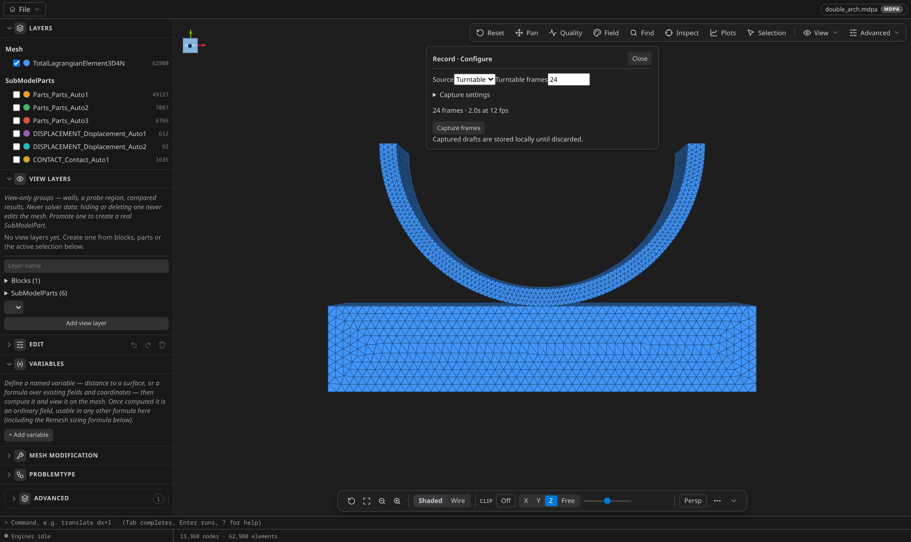

**View ▾ ▸ Record…** turns the viewport into an animation. Two sources: a **turntable** that spins the camera through one full revolution (available for any mesh, including `.mdpa` files with no time dimension), and a **time series** playthrough that steps through every frame of a mesh series.

The result is a **WebM** video, or a **numbered PNG sequence** if you would rather encode it yourself — the extension prints the exact `ffmpeg -i <stem>_%04d.png out.mp4` line when it saves them. mp4 is not offered directly because the browser engine VS Code is built on cannot reliably encode H.264; the PNG route is the honest answer rather than a format that sometimes fails.

Each frame is captured only once the frame it depends on is genuinely on screen, so a recording of a time series is a faithful playthrough rather than whatever happened to be drawn when a timer fired — worth knowing because every step of a series is a full re-read from disk, so a long recording takes real time. The progress bar counts frames, and **Cancel** keeps whatever was captured.

In a split view the recording includes every pane, with the pane separators drawn in so it matches what is on screen. A turntable spins the focused pane.

#### Split view

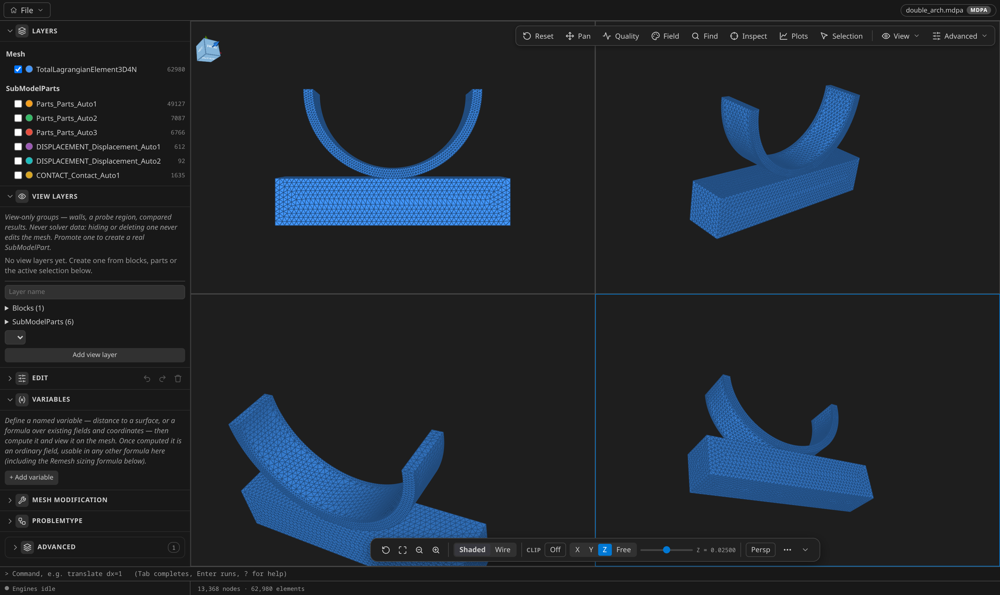

**View ▾ ▸ Layout** splits the viewport into 1, 2 or 4 panes. Each pane has its own camera over the same mesh, so you can look at the front and the top at the same time, or keep an overview beside a zoomed-in detail, without reloading anything.

Orbit, pan and zoom apply to the pane under the pointer. The pane you last pressed in is outlined, and that is the one **Reset**, **Frame**, the navigation dock and the keyboard view shortcuts act on — the orientation cube also turns to match it.

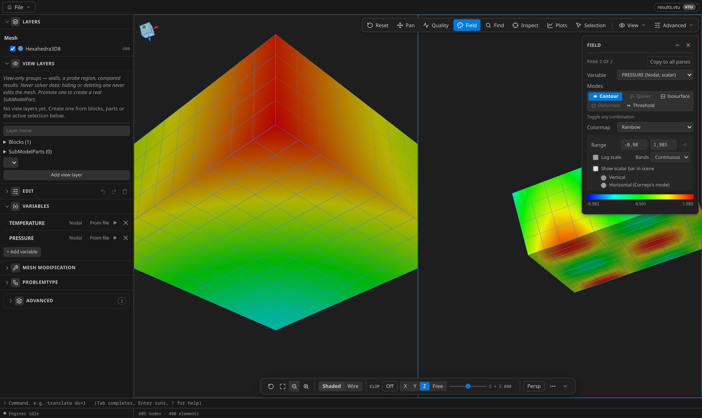

The **Field panel and the Clip controls also act on the focused pane**, so each pane can show a different variable, colormap, component, range, isosurface, threshold or deformation, and its own clip plane — the panel names the pane it is editing and offers **Copy to all panes** when you want them to agree. Click into a pane to point the panel at it.

Everything else stays shared: the same layers, visibility, colours, opacity and display mode appear in every pane, so a split is a second viewpoint rather than a second document. A screenshot captures the whole grid; in a split, switch on **Show scalar bar in scene** so each pane's legend is part of the picture.

Node IDs are shown in the single-pane layout only: they are drawn as HTML labels projected through one camera, so in a split they would land over the wrong panes.

**Comparing two meshes or runs:** open each in its own preview and use **Advanced ▸ Link previews…** to link them, so the camera, coloured field, colour map and range, clip plane and physical time of one drive the other (each its own switch). Time is matched by physical time — exact, or nearest within a tolerance — never by frame number, and a time or field the other mesh cannot honour is reported rather than guessed. The compared runs are remembered with the view.

#### Plot over time

**Inspect ▸ Plot over time** and **Plot** beside a field value now append a history to the embedded **Plots** pane. Use **Add points from mesh** for several points on the same chart, components or magnitude, and **Locate peak** to find the full-resolution maximum. Advanced settings support statistics, XY relationships and saved configurations. The [scientific plotting guide](doc/guide/scientific-plots.md) also covers regional analysis, standalone table imports and line-probe shortcuts. The image below shows the earlier single-history panel, whose extraction core is retained.

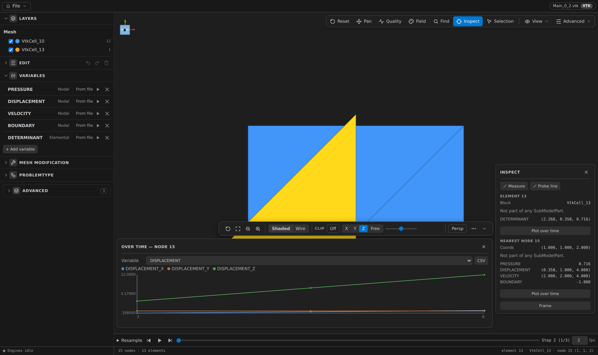

Reading one number at one step is what **Inspect** does. This answers the other half: what that number did across the whole run. Pick a node or element, choose a variable, and the extension reads every step of the time series and charts it.

The scan runs in the extension host, not in the preview — the viewer only ever holds one frame, so charting from it would mean stepping the whole timeline and watching the viewport flicker through every frame to read one value. Progress is shown per step and the scan can be cancelled; a partial series is still plotted.

What it will not do is quietly make the data look tidier than it is. A step where the variable is not written, or where the entity does not exist, leaves a **break in the line** rather than a segment drawn through it, and the panel says how many steps were missing and which of the two reasons applied. If the mesh changes size partway through the series, it says that too — the id still resolves, but it may no longer be the same entity. Edit operations from the sidebar are not replayed per step (that would cost as much as scrubbing the timeline by hand), so if any are applied the panel tells you the values are the ones on disk.

Clicking a point jumps the 3D view to that step. **CSV** saves the series. Also available headlessly as the `mesh_field_series` MCP tool.

#### Line probe

Inspect answers "what is the value at a point" (a click) and Plot over time answers "what did one entity do across the run"; the **Probe line** answers the third combination — what the field does along a line, at one step. Toggle **Probe line** next to Measure, click two nodes, and a profile chart opens: distance along the line on the x-axis, the chosen nodal field on the y-axis, one line per component.

The sampling runs in the extension host through one `meshAnalysis` round trip, so the plot's numbers are exactly `mesh_probe`'s for the same endpoints. A sample the mesh cannot answer — the line leaving the domain, or a region the field was never written to — is a break in the line, never a bridged segment, and the panel counts how many samples were uncovered. In a mesh series the plot follows the timeline step: stepping or playing re-samples the same two endpoints on each frame, and a reply that arrives late (a step whose sampling straggles behind the newer one during playback) is dropped rather than allowed to overwrite the newer profile. **CSV** saves the current profile. Works in both previews, including filename MDPA series; without a series it is a single-frame profile. **Plot builder…** opens the embedded workspace with a fixed captured profile and an explicit **Follow timeline** option.

#### Streamlines

Open **Advanced ▾ ▸ Streamlines…**, pick a **Nodal vector field** (2 or 3 components; a cell field must be moved to the nodes first with Average field) and say where the lines start: typed **Points** (one `x y z` per line, or **Pick seeds** and click nodes in the scene), a **Line** of equidistant seeds, a **Plane** lattice `origin + i/(nu−1)·U + j/(nv−1)·V`, or the nodes of a **SubModelPart** and its children. **Trace** draws the lines over the mesh coloured by speed; **Both** directions gives two lines per seed, one each way.

The integration is a fourth-order Runge–Kutta in arc length through a point locator built on the mesh's own cells, so a step is a distance — a fraction (default 0.25) of the cell it is in — and does not shrink where the flow is slow. Three caps bound a line: **Max steps** (default 2000), **Max length** (default five bounding-box diagonals) and at most 1000 seeds (more are refused, not truncated). Every line ends for a reason the export records: it reached a cap, **left the domain**, ran into a **stagnation point** (speed below 10⁻⁶ of the field's largest magnitude), or met a node that carries **no value** — the field is never extrapolated. A seed outside the mesh, or at zero speed, gives no line and is counted in the summary instead of disappearing.

These are **steady** streamlines of the frame on screen — the field frozen at one instant. They are not the paths particles would take in a changing flow (pathlines), and edit operations applied in the sidebar are honoured. Stepping the timeline re-traces the same seeds on the new frame. A plane lattice can be taken from the focused pane's clip plane (**Use clip plane**), and orange markers preview the seeds while the panel is open. The overlay draws lines or tubes, both coloured by speed; tubes are generated surfaces (view-only) and the export is line cells either way. **Export…** writes one node per vertex and one `Line2D2N` per segment, with nodal `STREAM_SPEED`, `STREAM_VELOCITY` and `STREAM_ARCLENGTH` and per-segment `STREAM_LINE`, `STREAM_SEED` (0-based), `STREAM_DIRECTION` (+1 forward, −1 backward) and `STREAM_TERMINATION` (0 max length, 1 max steps, 2 left the domain, 3 stagnation, 4 missing data); `.vtu` keeps all of them. Also available headlessly as `mesh_derive` with `kind: "streamlines"`, which shares the numerical core.

#### Data table

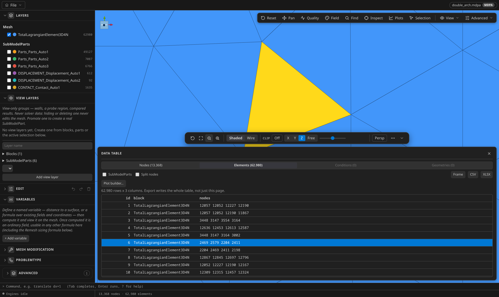

Every node, element, condition or geometry as a row of plain values — the id, the coordinates (nodes) or the block and connectivity (entities), optionally the SubModelParts it belongs to, and every field defined at it. A vector field splits into `NAME_X`/`NAME_Y`/`NAME_Z` columns (a wider one, such as a Hessian, into `NAME_0`…`NAME_n`), and a field that does not cover a row leaves the cell blank rather than showing a zero the mesh does not carry.

Clicking a row highlights and frames that entity in the 3D view, so a number in the table can be found in the mesh without leaving the panel. The table paginates at 100 000 rows and renders only the visible window, so it opens on a multi-million-entity mesh as quickly as on a small one.

**CSV** and **XLSX** export always write the whole table, not the visible page. CSV is streamed, so it has no size limit beyond your disk; XLSX is capped by Excel's own worksheet limit (1 048 576 rows) and tells you when it had to leave rows out. Coordinates export at their true `float32` precision rather than the `0.10000000149011612`-style expansion a naive conversion produces. Also reachable from the Command Palette (**Kratos Mesh: Export Data Table**) and from the `mesh_export_table` MCP tool.

#### Export skin

Extracts the boundary of the mesh's volume cells (plus any pre-existing surface cells) as a standalone surface mesh and writes it to a file of your choice, via the same format picker as File ▸ Export. Unlike meshio++'s own surface/skin extractors, this is a native boundary-face walk — a face seen by exactly one cell is boundary — so SubModelParts survive the extraction, narrowed to node membership (element/condition membership cannot follow, since the skin's faces get fresh entity ids with no correspondence to the source mesh). Also reachable from the `mesh_extract_skin` MCP tool.

#### Simplify surface and Level of detail

**Advanced ▸ Tessellate curved cells…** writes a *linear copy* of the mesh's quadratic cells (6-node triangles, 8/9-node quads, 10-node tetrahedra, 27-node hexahedra, 0–5 levels): the open mesh keeps its curved cells and every cell of the copy carries `SOURCE_ENTITY_ID`; `mesh_derive` (`kind: "tessellate"`) is the headless route. A `.vtu` or meshio++ polyhedron is still drawn as the tetrahedra it is decomposed into, but its original faces are remembered and the `.vtu` writer emits the real polyhedron again until an edit changes the mesh. **Advanced ▸ Simplify surface…** writes a decimated *copy* of a triangle surface (quadric-error edge collapse): boundary and crease vertices are pinned, surviving faces keep their entity ids, property ids and cell-field values, and the report gives the reduction and the largest collapse error as a share of the bounding-box diagonal. **View ▸ Level of detail** draws a decimated surface in place of the full layers to keep a huge mesh navigable — the mesh is untouched and picking is off while it shows. `mesh_derive` (`kind: "decimate"`) is the headless route.

#### Sample to grid

**Advanced ▸ Sample to grid…** (or **Kratos Mesh: Sample to Grid**) samples the surface — or the boundary skin of a solid — onto a regular lattice and writes it as a *new* file: a **voxel occupancy** (cells whose centre is inside the surface, with a `VOXEL_OCCUPANCY` 0/1 field) or a **signed-distance volume** (the distance to the surface at every lattice point, negative inside, as `SDF_DISTANCE`). It asks for the cell size, shows the cell count and memory it implies **before anything is allocated**, confirms above five million cells and refuses beyond twenty million. A complete lattice can be written as **`.vti`** — the only container that keeps the `sdf:*` header (origin, spacing, dimensions) — while a partial voxelization or an octree goes to `.vtu` or another cell format. This complements the *Signed distance* operation, which samples only the open mesh's own nodes. The same builders are the `grid`, `voxelize` and `sdfVolume` kinds of `mesh_derive`.

#### Octree volume mesh, CAD face meshing and generated meshes

**Advanced ▸ Sweep, mirror and layers…** runs one of the meshio++ 17.23.0 kernels on the open mesh and writes a new one: `extrude` and `revolve` sweep a line or surface mesh into hexahedra or wedges, `mirror` reflects it in a plane, `boundaryLayer` grows prism layers of a chosen first height from a closed skin, `tetrahedralize` fills a skin with tetrahedra (the native octree mesher here, as Netgen is not built in), `errorSize` turns an error array into a size field and `checkConformity` counts hanging nodes and T-junctions. Options are the kernel's own, edited as JSON; the same kinds are in `mesh_derive`. meshio++ 18.1.0 adds `convexHull` (a closed hull surface, or a loop in 2-D, with each vertex's input node in `SOURCE_NODE_INDEX`), `delaunay2d`, `reconstructSurface` (a surface through an oriented point cloud), `estimateNormals` and `parameterize` (a UV atlas, kept as the 2-component nodal field `UV` because the model has no texture-coordinate slot). meshio++ 18.3.0 adds `cutLevelSet` (keep the part a level-set point field selects, e.g. `phi < 0`, cutting cells exactly) and `cutQuadrature` (that part's quadrature rules as a point cloud with `QUADRATURE_WEIGHT` and friends); both need the full meshio++ artifact. For a STEP/IGES input, `mesh_info` and `mesh_convert` take `cadRead` (`deflection`, `angularDeflection`, `heal`, `sewTolerance`) to control the triangulation and heal the shape before it is read.

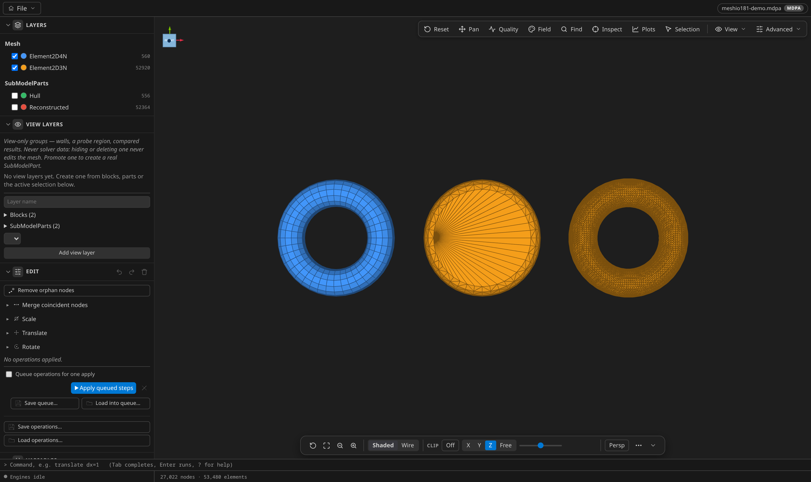

The seven in-place operations of 18.1.0 — **Untangle**, **Morph**, **Register (rigid ICP)**, **Geodesic distance**, **Surface eigenmodes**, **Cylindrical / spherical components** and **Prepare MMG metric** — are forms in the Mesh Modification sidebar (Fields), commands in the command line and ops of `mesh_transform`; they keep node and entity ids, Properties, SubModelParts and fields. Compressed `.gz` and single-file `.zip` meshes are read by the headless readers (`mesh_info`, `mesh_convert`, …), and a length unit a file states (STEP/IGES: mm; UNV, CGNS, MED) becomes the model's coordinate unit.

**Advanced ▸ Octree volume mesh…** meshes the inside of the surface (or of a solid's skin) on a balanced octree as tetrahedra, hexahedra or castellated hexahedra (meshio++ 17.13.0), **Mesh CAD faces…** triangulates the faces of an open `.cad.json`/STEP B-rep into one conforming surface with a SubModelPart per face (an optional JSON prompt adds meshio++ 17.21.0's minimum-angle refinement and smoothing, curved `order: 2` elements, curvature / gap / per-face / per-edge / background sizing and a report of what each did), and **Generate mesh…** writes a procedural mesh (rectangle, box, disk, spheres, cylinder, annulus, L-shape, plate with a hole, honeycomb…) from nothing. All three are exports, never edits of the open mesh, and `mesh_derive` reaches them as `octreeMesh`, `octree`, `cadSurface` and `generate`. **Segment surface patches** and **Refine patches** (Mesh modification) label the smooth patches of a surface as a `SEGMENT_PATCH` field and refine them until a plane, sphere, cylinder, cone or torus explains each. The `.step` export's fit also accepts meshio++ 17.13.0's freeform options (`freeformMode`, `extraordinaryVertex`, …) and the report states the freeform census. See the [guide](https://loumalouomega.github.io/VSCode-MDPA-Preview/guide/mesh-editing).

#### Export partitions and Split mesh

**Advanced ▸ Export partitions…** writes the mesh as *N* per-part files plus a manifest, with optional **ghost layers**: every cell is owned by exactly one part, each part is rebuilt natively from the source cell ids so ids, kinds, Properties, SubModelParts and fields all survive, ghosts are flagged (`PARTITION_GHOST`, a `Ghost` SubModelPart, `PARTITION_INDEX` = the owner), and the manifest lists interface nodes and imbalance. **Split mesh…** writes one file per connected body, element type or field value. The cut is a space-filling curve by default, or KaHIP (minimizes the edge cut; offered in the prompt and as `method: "kahip"` in MCP). Both are the `mesh_split` MCP tool.

#### Sphere / particle elements


Peridynamics and DEM meshes are made of **one-node elements** — Exodus writes them as `SPHERE`, Kratos DEM as spherical particles. They have no extent, so by default they draw as fixed-size screen points, which tells you nothing about how big the particles actually are.

The **Spheres** toolbar button renders them as real spheres instead, scaled in model space so they behave like geometry under zoom:

- **RADIUS field** — when the mesh carries one (an Exodus per-element `RADIUS` attribute arrives as an `Elemental` field of that name), every particle is drawn at its own radius, and the rendering turns on automatically.
- **Constant radius** — most particle files carry no radius at all. The panel suggests one (half the median nearest-neighbour spacing, so touching particles read as touching) and you can override it.
- **Scale**, **detail** (sphere tessellation) and optional **colour by radius**.
- **Write to mesh** turns the constant into a real `RADIUS` field. It is a normal, undoable mesh operation, so it saves, exports and appears in a saved recipe — also reachable from the **Set element radius** form in the Mesh Modification sidebar (which can also *scale* existing radii, and can target a single SubModelPart), and from the `mesh_transform` MCP tool.

Exporting such a mesh to `.exo` writes the radius back as an Exodus element attribute; exporting to `.mdpa` writes a `Begin ElementalData RADIUS` block.

#### Beam / line elements

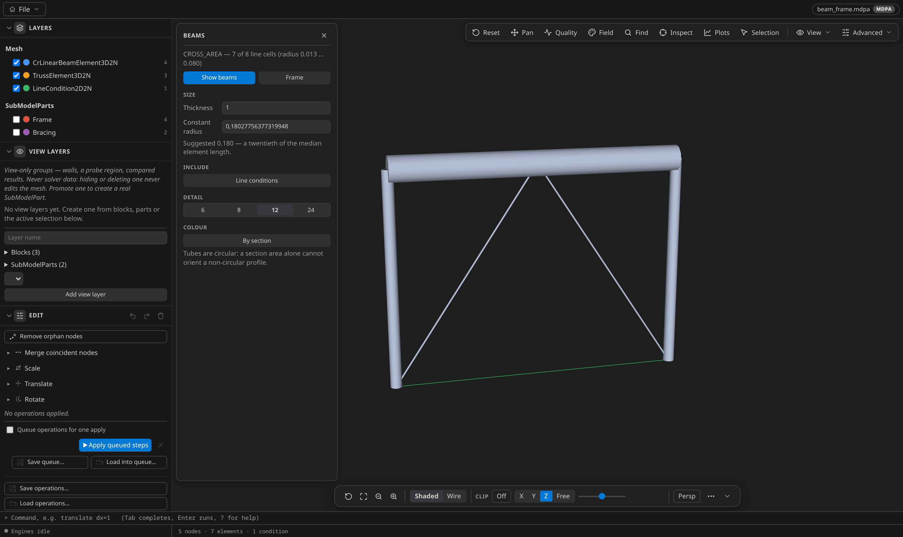

A frame or a truss is made of **line elements** with a cross-section. They have no extent either, so by default they draw as fixed-width screen polylines — a 6 mm tie rod and a 600 mm girder look identical at every zoom.

**Advanced ▸ Beams…** draws them as real tubes, scaled in model space:

- **`CROSS_AREA` from the `Properties` block** — where Kratos actually keeps a member's section. The drawn radius is the circular-equivalent `sqrt(A / π)`, resolved **per cell** (repeated `Begin Elements` blocks merge into one layer, so a single layer routinely holds members on several properties). An `ElementalData CROSS_AREA` field is used when Properties carry none.
- **Constant radius** — a twentieth of the median element length, for a mesh that declares no section.
- **Thickness** multiplies the radius only, never the length, so a member never detaches from its end nodes. Plus tessellation and optional **colour by section**.

#### Volume view

A mesh that is a dense regular lattice (a `.vti` file, or a grid from **Advanced ▸ Sample to grid…**) can be shown as a **volume** with an editable opacity curve, three orthogonal **slices** or marching-cubes **iso surfaces** from **Advanced ▸ Volume view…**. It is display only; **Surface** brings back the ordinary view. See the [Volume View guide](https://loumalouomega.github.io/VSCode-MDPA-Preview/guide/volume-view).

A line cell is also the shape a 2D **boundary** takes, so the rendering only turns itself on when the mesh gives it a reason to: the section must be a real `CROSS_AREA`, and only *Elements* count towards enabling it — a `LineCondition2D2N` skin that happens to share a structural part's property id never flips it on. Draw such conditions deliberately with **Line conditions**.

The section is read, not written: it belongs in `Properties`, which a Save emits from the model. `mesh_info` reports a `properties` section with the parsed values, and a `beams` section describing the line cells. See `example/MDPA/portal_frame.mdpa`.

</details>

### Known limitations

- MPI rank > 0 files are not merged in this release (rank-0 files are loaded).
- Submodelpart merging uses coordinate matching (`toFixed(6)`); if the root and subpart files were written at different float precision the merge may miss nodes (a diagnostic is emitted in the sidebar stats).

## MCP server

The extension ships a standalone [MCP](https://modelcontextprotocol.io/) server (`dist/mcpServer.js`) that exposes its mesh and simulation-setup engine to any MCP client (Claude Code, Claude Desktop, …) — no VS Code needed. Build it once with `npm run compile`, then register it, e.g. with Claude Code:

```bash
claude mcp add kratos-mdpa -- node /abs/path/to/VSCode-MDPA-Preview/dist/mcpServer.js
```

or in a generic client config:

```json
{ "mcpServers": { "kratos-mdpa": { "command": "node", "args": ["/abs/path/to/dist/mcpServer.js"] } } }
```

<details>
<summary>Complete MCP tool reference</summary>

**Export reporting:** single-mesh write tools, including `mesh_compare` with `outputPath`, return `report` and accept `provenance` / `verify`. `mesh_split` manifests contain per-file `reports`; `mesh_batch_transform` entries persist their report across resume. `mesh_pack_series` / `mesh_resample` return compact per-step `reports`, with one collection sidecar when requested. Structured VTI and temporal XDMF do not borrow unstructured/single-mesh fidelity claims. `problem_pack` embeds a provenance/recipe/hash record (`none` opts out). See [Export Report & Provenance](doc/guide/export-report.md).

<!-- BEGIN GENERATED: mcp-tools -->
| Tool | What it does |
| --- | --- |
| `plot_table_read` | Inspect a CSV/TSV table without a mesh: delimiter/header correction, explicit numeric columns and supplied units, missing/nonfinite values as gaps. SHA-256 source revision and diagnostics; JSON defaults to 100 rows, max 10000. |
| `plot_dataset` | Evaluate a version-1 scientific plot recipe with table/inline/mesh/history/probe/region sources. Thirteen families include line/step/area, pure scatter, bubble, bars, pie/doughnut, histogram/box, masked heatmap/contour and polar (X = angle in presentation.angleUnit deg or rad, Y = radius). Pie/doughnut require an explicit category statistic and nonnegative weights with a finite positive total; host-computed shares are returned, without claiming disjoint physical regions. Bubble requires an explicit numeric size column; missing/negative/zero sizes are not drawn. Regional entity reductions, reaction sums/moments, boundary scalar means/integrals, pressure forces/moments and vector flux share the UI's read-only quadrature, with explicit associations, normals, moment origin, thickness/density and coverage. Ordered numerical transforms, reference alignment and explicit masked gridding. Probe timeStep is a captured frame index; followTimeline is UI intent and never discovers an active preview. Shared cancellable host worker; styling is ignored numerically. Bounded JSON or CSV plus .kratosplot.json with ALL derived/original values and provenance; physical units/time are not inferred. Optional cacheDir (or the KRATOS_PLOT_CACHE_DIR environment variable) enables a bounded on-disk cache of mesh/probe/region/history extractions keyed by source, companion and timeline content revisions; a changed or missing file is a miss, and the cache never serves a stale or live-snapshot extraction. |
| `plot_preset` | Build a named plot recipe and optionally evaluate it. Presets: fieldDistribution (histogram of one component or the magnitude of a Nodal/Elemental/Conditional field over the mesh entities or one SubModelPart at the current frame; params.components is the field width, entities the field does not cover are excluded and reported, never zero) sectionComparison (a field's boundaryMean/mean over time for two or more SubModelParts, history scope; differences are not derived; an optional pressureDensity in kg/m³ converts a field recording SI kinematic pressure to Pa, never inferred) volumeTotal (sum of a scalar Elemental field times element length/area/volume, per SubModelPart or whole mesh; elements without a value or measure are excluded and reported, never zero) tensorComponents (one curve per component index of a tensor/vector field over time for a SubModelPart; named by index only, no Voigt or invariant meaning inferred), tensorInvariants (trace, hydrostatic, vonMises, j2, deviatoricNorm, principalMax/Mid/Min, maxShear of a tensor field over time for a SubModelPart; params.layout is REQUIRED and never inferred: "full3x3" (row-major xx,xy,xz,yx,yy,yz,zx,zy,zz), "full2x2", or explicit indices {xx,yy,zz?,xy,yz?,xz?} for a Voigt-style order; missing zz/yz/xz are zero (plane problem); shear "engineering" halves off-diagonals; operation mean/min/max; a non-finite row is a gap), heatFluxBalance (flux of a supplied nodal heat-flux vector through boundary SubModelParts over time; positive is out of the domain, no conductivity or gradient inferred) and tableRelationship (one supplied table column against another, e.g. load vs displacement; x/y are the importer's column ids c0, c1, … in file order as shown by plot_table_read; units only as supplied). With evaluate (or a threshold) the recipe runs through the same worker as plot_dataset. threshold applies a user-supplied limit and direction to the evaluated curves: equality is not a violation and gaps are counted separately, never passed or failed. With differences ([{from, to}] series ids) an evaluated run also reports from − to at exactly matching x (unmatched x or a gap is a gap; differing units are refused). Without evaluate it returns only the validated recipe for plot_dataset. |
| `plot_runs` | Discover existing saved/tracked runs from explicit execution-receipt/latest-run-sidecar paths or directories (directory and immediate child run directories only; bounded scan). Reuses the existing run store; never infers ownership from matching filenames or an active case. Live/uncertain runs and legacy shared-output sidecars remain unresolved. Listed terminal isolated results must pass plot_run_bind before claiming ownership. |
| `plot_run_bind` | Pin a recorded result of an observed terminal isolated run. Verifies the existing .kkss-execution.json receipt, owning job/request/study IDs, source mesh, selected filename rank/timeline/subparts and recursive result companions by SHA-256. OpenFOAM, Elmer and MFEM directory-backed results additionally require a frozen complete inventoryRevision covering files, directory paths and timeline; marker/file hashes alone are refused. Refuses missing/changed revisions, linked case dependencies, outside results and unsupported inventories. Returns the run binding for a mesh/history/probe/region plot source; collection verifies it before and after reading. Does not create a run or rewrite provenance. |
| `plot_run_resolve` | Explicit ownership resolution for one result path. status "verified" only with a recordPath naming an existing .kkss-execution.json receipt whose recorded job/request/owner IDs, source mesh and result/companion revisions still verify (returns the same binding as plot_run_bind). status "unverified" for a legacy run, a latest-run .kratosrun.json sidecar or no record: returns only a present-state snapshot revision, explicitly NOT ownership, which cannot be used as a run binding. status "unresolved" when a receipt exists but is stale, reused, non-terminal or lacks revisions, or the source cannot be read. Read-only; never scans for receipts and never infers past ownership from current bytes, paths, frame indices or entity IDs. |
| `plot_time_cursor` | Resolve an exact or tolerance-bound nearest physical-time cursor in its verified owning run. Supply timeUnit and, for filename steps or unknown/different in-file units, a strictly increasing physical-times mapping (one per available frame). Never converts units, extrapolates beyond tolerance, chooses an equal-distance tie, maps entities between meshes, or redirects any preview. Returns matched:false for unmatched/ambiguous times; changed run/source/companion identities fail. |
| `plot_run_target` | Resolve an exact verified owning-run source/rank/frame and check entity presence in its original association or a SubModelPart. Never infers correspondence across runs/remeshing, never opens an active preview. The UI uses this same target contract before and after loading the owning preview. |
| `mesh_resample` | Export a resampled timeline as PVD/VTU. Linear interpolation requires matching topology and metadata. Integer fields are never blended; unknown fields require explicit continuousFields (kind:variable). Source files are unchanged. |
| `mesh_periodic` | Match periodic SubModelPart nodes under an affine transform. Reports original node IDs; optionally exports CSV. Does not create solver constraints. |
| `mesh_info` | Parse a mesh file and summarize it: node/element/condition counts, bounds, entity blocks, the SubModelPart tree, data fields, parser diagnostics, and — for a multi-step mesh (Exodus, GiD, XDMF, OpenFOAM time directories) — the selected step and every available time value. Six sections appear only when the mesh has the thing they describe, so an ordinary mesh's report is unchanged: `properties` (an .mdpa's parsed `Begin Properties` values — the id space blocks[].propertyIds points into, so a cell's material or section can be resolved without reading the file), `constraints` (an .mdpa's parsed `Begin Constraints` blocks — Kratos master/slave constraints: per block its name, variables, row count and id range, plus `verbatimRows` for rows this extension could not decompose and `undefinedIds` for constraint ids a SubModelPart lists that no block defines, which is a file Kratos cannot read back), `source` (a MED file's own mesh name, description and units — coordinate, time and per-field, when the file actually sets them), `spheres` (one-node/particle cells: how many, whether they carry a RADIUS, and a suggested one if not), and `beams` (line cells: `sectioned` counts those resolving a CROSS_AREA, while the stricter `elementsSectioned` counts only Elements — a mesh where the two differ sharply is usually a 2D boundary skin sharing a structural part's properties, not a frame), and `isolatedNodes` (nodes referenced by no cell connectivity — connectivity-only, so a node listed in a SubModelPart but in no block still counts: `count` plus the `ids`, capped at 1000 with `truncated: true` when capped). Pass `summary: true` to report the file shape WITHOUT parsing it, for every supported format, with an explicit `cost` saying what that took. |
| `mesh_quality` | Compute geometric mesh-quality metrics (edge ratio, min/max angle, size gradation) with Kratos-default thresholds; returns per-metric statistics, band percentages, and the worst element ids, plus a `watertight` section counting the boundary's holes (boundaryEdges), non-manifold junctions (nonManifoldEdges), inconsistently wound face pairs and zero-area faces — the counts rather than a bare flag, since three boundary edges is a pinhole and three thousand is an open surface. A `surfaceDefects` section says WHERE, for the mesh's own triangle/quad cells: the node-id pairs of hole-rim (boundaryEdges) and non-manifold edges, and the ids of faces wound against a neighbour or of zero area, each capped at defectLimit with the true total beside it (surfaceCellCount 0 = nothing to check; a solid's boundary is not a surface a repair changes). Fix them with mesh_transform's repairSurface op. |
| `mesh_field_integrate` | Cell-measure-weighted total and mean of the Elemental/Conditional fields — a density field's total mass, a flux field's total power, an occupied volume. Reported for the whole mesh AND independently per named region, which here means one row per entity block and one per SubModelPart, so this is the per-part breakdown. Regions overlap rather than partition: a cell in two of them contributes fully to each, so region totals need not sum to the domain total. A cell whose measure is not computable, or a component whose value is non-finite, is excluded from that component's numerator AND denominator rather than given a fallback weight of 1. Read-only. A Nodal field is refused by name — move it to the cells with mesh_transform's averageField (nodalToElemental) first. For an axisymmetric result stored on the r-z plane, pass revolveAbout "x" (r = y) or "y" (r = x): each cell is then weighted by 2*pi*r and the result says "revolved about &lt;axis&gt;". With revolveAbout a NODAL field is accepted too: it is integrated with exact lumped nodal weights (2*pi*A/12*(sum r + r_j) per triangle corner, 2*pi*L/6*(2 r_j + r_other) per line end; a node on the axis keeps a positive weight; a node without a value is a gap, never 0). Never inferred; a 3D mesh, a mesh crossing the axis or any other axis is refused by name. Without it the integral stays the plain r-z plane one, labelled as not revolved. |
| `mesh_flow_balance` | Signed boundary flow balance of a solved mesh: the volumetric flux integral(u . n dA) through each named SubModelPart of Conditions (`sections`), the area-weighted mean of a nodal pressure on each, the net flux and imbalance across them, and an optional pressure drop between two sections. Positive flux is OUT of the domain, so an inlet reads negative and a balanced set of boundaries sums to zero. `imbalance` = net / max(total inflow, total outflow), null with a stated reason when there is no flow. This is a true flux integral, not mesh_field_integrate's measure-weighted total: each facet is fan-triangulated and contributes mean(corner velocity) . area vector, exact for a linear field, over corner nodes only. `orientation` "outward" (default) flips each facet's normal away from the single Element it belongs to — a facet with no adjacent Element, or shared by two (internal), is counted and EXCLUDED, never guessed; "winding" trusts the Conditions' own node order. A facet with a corner lacking a value is a gap: excluded from that quantity and reported as uncovered area, never read as 0. A 2D mesh (line Conditions bounding surface Elements) gives flux PER UNIT DEPTH, stated in `fluxUnit`. Mass flux exists only when you pass an explicit positive `density`. `pressureDrop` {from,to} (section names) reports mean(from) - mean(to) of the pressure field in its OWN units and gauge/absolute reference; it is unavailable, with a reason, when either section has no pressure. `pressureDensity` (a positive kg/m³, never inferred and never falling back to `density`) additionally reports the means and the drop scaled to Pa, but only when the pressure field's dimensions are exactly kinematic pressure [m²/s²] — an unknown, already-Pa or other dimension reports the conversion as unavailable with the reason; `pressureReference` (gauge/absolute) only labels it. `velocity` (default VELOCITY, a 2- or 3-component NODAL vector) and `pressure` (default PRESSURE, a nodal scalar): an absent default is a warning, an absent explicit name is an error. With allSteps it repeats over every step of the time series (a step that fails to parse is recorded and skipped, never fatal). outputPath writes a .csv (per section for one step; one row per step with allSteps). Read-only. |
| `case_evaluate_quantity` | Evaluate one explicitly selected scalar from a solver result and return a version-1 review record bound to the run id and result-file content revision. Select the field, location, component, region, time step, reduction and unit; units are required and never guessed. Uses the mesh parser's existing field and reduction routines, reads without modifying the result, and leaves missing/non-finite values null. |
| `mesh_intersections` | Where a SURFACE mesh (triangles/quads; a solid is refused — extract its boundary with mesh_extract_skin) intersects ITSELF, or with otherPath where two surfaces interpenetrate or touch, by exact triangle-triangle tests (meshio++ &gt;= 18.0.0). Returns clean (true = none), the number of facet pairs / triangle pairs / coplanar pairs / intersection segments, and the entity ids of the facets involved per kind (capped by idLimit; the totals are not). Read-only; to WRITE the intersection curve as a line mesh use mesh_derive kind findIntersections, and to select the offending facets in the viewer use the Mesh-analysis panel. The fix for a self-intersecting surface is not automatic: repair it (mesh_transform repairSurface) or remesh it. |
| `mesh_check_tetrahedra` | Counts the inverted (negative volume), degenerate (volume ~ 0) and overlapping tetrahedra of a mesh's Tetrahedra3D4N / Tetrahedra3D10N cells (meshio++ &gt;= 19.0.0), with the smallest and largest signed volume and valid (true = none of the three). Counts only: the kernel does not name the cells. Read-only; a mesh without tetrahedra is refused. To repair inverted tetrahedra use mesh_transform untangle, or regenerate with octreeMesh/tetrahedralize (volumeFix is on by default). |
| `mesh_contact_pairs` | Slave-node to master-facet pairing for a contact definition (meshio++ &gt;= 20.1.0 contactPairs). `slavePart` is the SubModelPart whose NODES are the slave points and `masterPart` the SubModelPart whose CELLS (elements or conditions) are the master facets; both are slash paths. Each pair reports the slave node id, the master entity (kind and id), the facet and sub-facet, the gap (signed distance along the master normal), the closest point, the master normal and the local coordinates. A slave node with no master within `tolerance` is listed in `unmatched` (ids), never given a gap of 0; requireComplete makes any unmatched node an error. With `outputPath` (.json or .csv) every pair is written; the reply returns at most `limit` pairs (default 200). Read-only: nothing in the mesh changes. |
| `mesh_measure` | Metrology on a scan or mesh (meshio++ &gt;= 20.0.0): builds ELEMENTS (planes, spheres, cylinders, points, lines…) fitted from named regions, seed points or patches, or constructed from other elements, then evaluates DIMENSIONS (distances, angles, diameters) and GD&T tolerances (flatness, cylindricity, position…) against limits, all from a JSON spec; returns the kernel's report (each element's fit, each dimension's measured value and pass/fail) and numFail. Give spec (an object or its JSON text) or specPath. Read-only; a malformed spec or an element that cannot be built is an error naming it. |
| `mesh_symmetry_plane` | The plane a mesh or scan is most nearly symmetric about (meshio++ &gt;= 20.0.0): returns its origin and unit normal, the rms of the mirrored points, the share of points that mirror within tolerance and the candidate chosen. A plane reaching less than minShare is an error rather than a guess. Read-only. Use it to find the mirror plane before mesh_derive mirror, or to check a part is symmetric. |
| `mesh_fit_cad_iterate` | Reconstruct a CAD solid from a surface scan in rounds (meshio++ &gt;= 20.0.0): segments the scan, fits primitives, builds a solid and re-measures the scan's deviation from it, refining the worst faces until the target share is within tolerance or the rounds run out. options are the kernel's (targetWithin, targetExplained, maxRounds, segmentTolerance, fitTolerance, partClass any\|analytic\|cast\|freeform, backend auto\|occt\|native, stepPath…). Returns the per-round share within tolerance / explained / Hausdorff max, whether the target was met and why it stopped. With outputPath the solid is written as a mesh (.step keeps exact geometry on the full artifact). Can take a while on a large scan. |
| `mesh_graph` | The connectivity graph of a mesh (meshio++ &gt;= 18.1.0), for partitioners, reordering and sparsity analysis: kind 'node' (nodes joined by a cell edge, default), 'clique' (nodes sharing a cell — the finite-element sparsity pattern) or 'cell' (cells sharing a facet, numbered block-major). Returns the vertex and edge counts, the degree range and the BANDWIDTH of the current numbering (compare it with mesh_transform's reorder rcm). With outputPath it also writes a METIS (.graph) or Scotch (.grf) file; vertices are 0-based positions in the stored order, not Kratos ids, and the file is 1-based as the format requires. Read-only: the mesh is never changed. |
| `mesh_curvature` | Discrete curvature of a SURFACE mesh (triangles/quads; a solid is refused — extract its boundary with mesh_extract_skin): per-node mean H, Gaussian K and optionally the principal curvatures k1 &gt;= k2, via meshio++. Returns per-field statistics (min/max/mean and the number of nodes with a defined value), the sum of the angle defects against 2*pi*chi (Gauss-Bonnet — their difference gaussBonnetResidual is ~0 for a sound closed surface and absent for an open one), the boundary/isolated/degenerate node counts and the watertight counts. A sphere of radius R reads H = 1/R and K = 1/R^2. The SIGN of H follows the winding: a uniformly inside-out surface reads -1/R, and a mesh whose faces disagree on winding is flagged in warnings (fix it with mesh_transform's repairSurface first). Boundary nodes of an open surface have no curvature and count as gaps unless includeBoundary is set. Read-only: to write the fields onto the mesh (CURVATURE_MEAN, CURVATURE_GAUSSIAN, CURVATURE_K1/K2 — usable in remesh sizing formulas) run mesh_transform's curvature op. |
| `mesh_recover_flux` | See where a support or wall carries its load. Kratos reports reactions (REACTION, REACTION_FLUX) as nodal LOADS, which can be summed but not seen as a per-area field. This recovers a traction / flux field on the surface Conditions of a SubModelPart (3/6-node triangles consistently, 4-node quadrilaterals lumped) by the consistent boundary-mass projection M t = F, solved per component by Jacobi-preconditioned CG. Dividing by a lumped area would show spots on a quadratic face (the corner loads of a uniform traction are zero); this does not. The integral of the recovered field over the whole part equals the reaction sum (reported as integralError). Over a subset of the faces it is that subset's integral, which equals that subset's reactions only where the cut does not split a node's load. The result is a DERIVED field (default &lt;variable&gt;_RECOVERED), labelled as recovered, never written into the source data; outputPath writes the mesh carrying it. |
| `mesh_ale_quality` | Did the mesh solver keep a moving (ALE) mesh valid? For every frame of a time series, measures each Element of the top dimension (volume cells, else planar xy surface cells) on its deformed coordinates (coordinates + the nodal displacement, default MESH_DISPLACEMENT) and compares it with the SAME element at the first frame, so an intentionally graded mesh is not flagged: measureRatio = signed measure / reference (&lt;= 0 means flat or inverted) and shapeRatio = signed mean-ratio quality / reference quality (1 = as good as at the start, negative = inverted). Returns per frame the inverted count and ids (capped at 50), the lowest ratios and the worst element, plus the overall worstFrame. A frame with a different element set or no displacement field is an error row, not compared by position. Read-only; .csv outputPath writes the table. |
| `mesh_fit_primitives` | Name the boundaries of a SURFACE mesh by shape (a solid is refused — extract its boundary with mesh_extract_skin first). Segments the surface into smooth patches (featureAngle, default 30 degrees; method angle\|primitive) unless it already carries SEGMENT_PATCH, then fits a plane, sphere, cylinder, cone or torus to each patch via meshio++ fitPrimitives and reports per patch: the primitive (or none), the cell count, the fraction of facets within tolerance, rms and max distance, and for planes/spheres/cylinders the point, axis/normal and radius ('these four patches are cylinders of radius 5'). Cone and torus parameters are returned raw. tolerance is relative to the bounding-box diagonal unless relative is false. Read-only; with outputPath the mesh is written carrying the integer FIT_PRIMITIVE cell field (1 plane, 2 sphere, 3 cylinder, 4 cone, 5 torus, 0 unfitted, -1 off the surface) so patches can be coloured by type. |
| `mesh_compare` | Compare two meshes and their fields, matched by ENTITY ID (so the two must share an id space — a re-run, an edit, a restart; the comparison is order-free). Native rather than meshio++'s diff, which would compare a lossy conversion that has already lost ids, kinds, Properties and SubModelParts. Reports a verdict (identical / equal within tolerance / different, where a value is equal when \|a-b\| &lt;= atol + rtol*\|b\|), node counts/only-in-A/only-in-B/moved and the max coordinate difference with the worst node id, per-kind entity counts (Elements, Conditions and Geometries are independent id spaces) with changed connectivity (node ORDER is the winding, so a rotated node list counts) and changed cell type, block names only in A/B, SubModelParts only in A/B and per-part membership differences (which upstream diff ignores), and per field: max/mean/RMS \|a-b\| (the Euclidean norm of the row difference for a vector), max relative error, the id of the worst row, rows outside tolerance, and ids present in only one mesh — a coverage gap, NEVER compared as 0; a non-finite value is likewise a gap. With `variable` it also compares that one field (kind default Nodal; `sourceVariable` if B names it differently) either by id or with correspondence "spatial": B's NODAL field is point-sampled (barycentric, through meshio++ interpolate — NOT the mass-preserving transferField) at A's nodes, for two different discretizations of the same domain; a node outside B, or whose sampling cell touches a node with no value, is uncovered (counted, gap in the output) — for a surface B, a point is covered when it projects inside a cell, its distance off the surface is not checked. Cell fields cannot be sampled spatially (move them to the nodes with averageField first). With `outputPath` it writes mesh A carrying &lt;base&gt;_DIFF (signed a-b), &lt;base&gt;_ABS (norm of the difference) and &lt;base&gt;_REL (relative, a gap where \|b\| = 0) — the difference mesh, identical to mesh_transform's compareField op. |
| `wind_tunnel_plan` | PLAN a virtual wind tunnel around a body surface without meshing anything: the body as measured (size, area, frontal area, whether it is closed), the tunnel extents and blockage, the flat-plate boundary layer (Reynolds number, friction velocity, first-cell height for the target y+, layers), the sizes, an estimate of the tetrahedra, memory and time, the ordered steps, warnings and errors (a plan with errors cannot run). Read-only. Use it to tune the parameters before wind_tunnel_generate. |
| `wind_tunnel_generate` | Build a virtual wind tunnel from a body surface in a few steps: a graded background lattice, distance-driven refinement (with a wake box), a level-set carve of the body, the named parts (Fluid, Body, Inlet, Outlet, Floor, Ceiling, SideLow/SideHigh or Symmetry), a stretched wall layer (MMG makes stretched tetrahedra, not prisms), hard mesh checks and a measured wall fit, then writes &lt;stem&gt;.mdpa, the placed &lt;stem&gt;_body.stl, &lt;stem&gt;.kratosvwt.json (parameters, report) and &lt;stem&gt;.kratoscase.json (the prepared Fluid — or Embedded Fluid — case: inlet, outlet, slip/no-slip walls, wall law, time stepping, force and coefficient monitors). With generateCase it also writes ProjectParameters.json, the materials file and MainKratos.py. Refuses to overwrite unless overwrite is true. Long: a few hundred thousand tetrahedra take about a minute, a few million many minutes; cancelling stops between steps. The flow is turbulent at wind-tunnel Reynolds numbers and no turbulence model is applied; the report says so. |
| `mesh_derive` | Write a NEW mesh derived from the opened one — not an edit (nothing is written back to the input; use mesh_transform for edits) and the same class as mesh_extract_skin. kind "slice" cuts the mesh's own cells with the plane through `origin` with `normal` (meshio++ slice) and gives the cross-section as triangles/quads; kind "isosurface" contours the NODAL field `variable` at each of `values` (a cell field is refused — average it first; `component` picks a vector's column, default the magnitude, which is approximate); both carry the interpolated nodal fields and per-cell fields of the parent cell, and tag every produced cell with SOURCE_ENTITY_ID / SOURCE_ENTITY_KIND (0 Elements, 1 Conditions, 2 Geometries) naming the cell of the input it was cut from (the isosurface adds ISO_VALUE and ISO_INDEX); node and cell ids are NEW, and named regions/SubModelParts do not carry over. kind "threshold" extracts the region where `variable` (of `fieldKind`, default Nodal) lies in an absolute `range` [lo, hi], or in `normalizedRange` [lo, hi] (0..1) of an explicit fixed `referenceRange` [lo, hi] — or of the frame's own range with referenceRange "frame", which changes the physical threshold from one time step to the next and is therefore opt-in. For a Nodal field `rule` "all" (default) needs every node of a cell in the window, "any" one; a cell field tests the cell's own value. The region KEEPS original ids, groups, fields and Properties: the Conditions and Geometries still lying on it stay, SubModelParts and fields are narrowed, and constraints reaching outside are dropped (counted in the summary). output "skin" returns the region's boundary surface instead (new ids). The summary states the selected share of the volume (or area, or length). Written to `outputPath` in the format its extension names (outputFormat picks an ambiguous flavour); .mdpa is legal but slice/isosurface cells carry meshio type names as block names, so prefer .vtu/.vtp/.stl/.ply for those. kind "igaRefine"/"igaSample" run the IGA kernel on the NURBS side channel the input CARRIES (set only by a read of a .cad.json, a .step/.igs file or an MFEM NURBS .mesh, and dropped by any applied edit, so the model must be unedited): refine h/p-refines the patches (subdivisions per knot span/direction, degree elevation, B-rep edge/trim controls) and sample tessellates them into Lagrange cells; both run on the lean build, keep the source untouched, and do NOT carry the channel on the result (write .cad.json/.mesh and reopen it to refine again). kinds "findInterface" / "splitInterface" / "regionAdjacency" (meshio++ &gt;= 20.1.0) work on SubModelPaths of ELEMENTS: findInterface (options.regionA, options.regionB, optional mode conforming\|proximity, gapTolerance, angleTolerance, overlapTolerance, master) writes the facets the two parts share as a triangle mesh carrying INTERFACE_GAP and INTERFACE_MEASURE; splitInterface (regionA, regionB, addCohesive default true) duplicates the nodes along the conforming interface and inserts zero-thickness cohesive cells (a new mesh, ids are not carried); regionAdjacency (options.regions, a list of part paths, default every region) writes the facets between every pair. kind "decimateVolume" (meshio++ &gt;= 20.1.0) does the same for a mesh of LINEAR TETRAHEDRA (same ratio / targetFaces (read as a tetrahedron count) / maxError / placement / preserve* / frozenPart arguments; surviving tetrahedra keep their ids, properties and element values; boundary Conditions are kept only while the boundary is pinned, the default). kind "decimate" writes a SIMPLIFIED COPY of a triangle surface (quadric-error edge collapse, meshio++): give exactly one of `ratio` (the fraction of faces to KEEP), `targetFaces` or `maxError`; boundary and crease vertices are pinned by default (`preserveBoundary`, `preserveFeatures`/`featureAngle`, so an open patch keeps its outline exactly) and `frozenPart` pins a SubModelPart's nodes. Surviving faces ARE the source faces — they keep entity ids, kinds, block names, property ids and every elemental/conditional field value (never averaged) — while a node keeps the lowest id merged into it and its nodal fields are upstream's blend of the collapsed endpoints (exact for midpoint/endpoint placement, an approximation for optimal); SubModelParts are narrowed to survivors and constraints are dropped with a warning. The summary reports faces before/after, the achieved reduction and the largest collapse error (also as a share of the bounding-box diagonal). Refused by name for volume cells (extract the skin first), quads (simplexify first), higher-order cells, and lines/points mixed with the surface. kind "tessellate" writes a LINEAR COPY of the mesh's curved cells (6-node triangles, 8/9-node quads, 10-node tetrahedra, 27-node hexahedra) tessellated through their own shape functions at `levels` (0-5, default 2; the same core as the mesh_transform tessellate op, but the input keeps its curved cells and nothing is adopted in place): every other cell passes through unchanged, the first child keeps its parent's id and siblings take fresh ids, children keep the parent's property, SubModelParts and cell-field values, Nodal fields are interpolated onto the new nodes, and every Element/Condition carries SOURCE_ENTITY_ID (the id of the cell it was tessellated from; the field kind gives the entity kind). A mesh with no curved cells, or a request over 5 million cells, is refused by name. Three kinds SAMPLE SPACE instead of cutting the mesh, each producing a regular lattice (a hexahedral mesh): kind "grid" builds `dims` cells from `origin` with `spacing` and needs NO `path`; kind "voxelize" builds a lattice around the input's surface (its own faces, or the boundary skin of a solid) and keeps the cells whose centre is inside (fill "inside", default), that a triangle passes through ("surface"), or all of them ("all"), writing VOXEL_OCCUPANCY; kind "sdfVolume" samples the signed distance to that surface (negative inside) as the nodal field SDF_DISTANCE (or per cell with location "center"), on a dense lattice or an adaptive octree (sized by rootResolution/maxDepth, with hanging nodes). Size a lattice with exactly one of `resolution` / `cellSize` (a request over 2e7 cells is refused BEFORE any work with the cell/point counts and an approximate size); padding is absolute plus paddingRelative of the bounding-box diagonal. A non-closed surface makes the sign unreliable near its defects and the summary says so (winding-number tolerates small holes). A DENSE lattice — grid, sdfVolume with structure voxel, voxelize with fill all — may be written as `.vti` (VTK ImageData), which the unstructured writers cannot produce and which alone keeps the sdf:* header (origin, spacing, dims, structure); a partial lattice or an octree must be written as .vtu or another cell format. kind "streamlines" traces STEADY streamlines of the NODAL vector field `variable` (2 or 3 components; an elemental field is refused — average it first) through the frame that is read (`timeStep` picks a step of a multi-step file) and writes them as line cells: give exactly one seed source — `seedPoints` [[x,y,z],…], `seedLine` {from,to,count} (equidistant, ends included), `seedPlane` {origin,u,v,nu,nv} (a lattice origin + i/(nu-1)·u + j/(nv-1)·v) or `seedPart` (the nodes of a SubModelPart and its subtree). Integration is RK4 in ARC LENGTH through a pure-JS point locator (no meshio++), a step being `stepFraction` (default 0.25) of the containing cell's size; `direction` forward (default), backward or both (two lines per seed); the caps are `maxSteps` (default 2000, at most 100000), `maxLength` (default five bounding-box diagonals) and `maxSeeds` (default 1000, at most 10000 — more seeds are REFUSED rather than truncated), and `minSpeed` is the stagnation tolerance relative to the field's largest magnitude (default 1e-6). Every line ends for a stated reason — STREAM_TERMINATION 0 max length, 1 max steps, 2 left the domain, 3 stagnation point, 4 met a node with no value — and a seed that gives no segment (outside the domain, or at zero speed) is listed under `streamlines.rejected` with its reason rather than dropped; the reply carries the counts per reason. Output: one node per vertex, one Line2D2N per segment, nodal STREAM_SPEED / STREAM_VELOCITY / STREAM_ARCLENGTH and per-segment STREAM_LINE / STREAM_SEED (0-based) / STREAM_DIRECTION (+1 forward, -1 backward) / STREAM_TERMINATION; .vtu, .vtp or .vtk are the natural targets. Not transient pathlines: the field is frozen at one frame, and applied edits are not replayed (run mesh_transform first if the mesh should be edited). kind "generate" makes a procedural mesh from nothing (no `path`): `shape` + `params` (rectangle, box, disk, uvSphere, icosaSphere, cylinder, referenceTriangle, ngon, annulus, lshape, plateWithHole, honeycomb, referenceCells, and since 17.23.0 line, circle, helix, spherePoints, boxPoints, tetraSphere, octaSphere, cubeSphere, geoSphere, torus, moebius, tube, cone, capsule, boxSurface, platonic, ball, sphericalShell, pipe, fichera, solidTorus; a `complete` param (true) adds every side region a shape can name; side regions such as xmin/rim/hole become SubModelParts). kind "octreeMesh" (meshio++ 17.13.0) meshes the INSIDE of a closed skin (the input's own surface faces, or the boundary of a solid) on a balanced octree: `options.output` tet (default, conforming graded tetrahedra), hex (all-hexahedra by the dual) or castellated (hexahedral leaves with surrogate-boundary faces); the summary states cells, leaves, dihedral range, scaled Jacobian, inverted cells and the boundary-to-skin distance, inside/boundary arrive as SubModelParts and SDF_DISTANCE as a nodal field. kind "octree" is the older adaptive octree (rootCells, minLevel/maxLevel, balance, fill; hanging nodes are not merged). kind "cadSurface" (17.13.0) triangulates the B-rep faces of a .cad.json (or STEP/IGES read) into one conforming surface with edges of about `targetSize`: one SubModelPart per face and a CAD_FACE field; a face that cannot be meshed is listed with its status and reason in the summary, never meshed wrong (`strict` fails instead). `cadOptions` (meshio++ 17.19.0–17.21.0) adds: `minAngle` (refine until every surface triangle's smallest angle reaches it, degrees under 60) with `smoothIterations`/`smoothMethod` (laplacian\|odt) and `lopCorners` (lop acute corners instead of concentric shells; effective only with minAngle) and `poleRings`; `order` 1 (linear) or 2 (curved triangle6/line3 whose nodes lie on the surfaces; order 3 is refused — the extension cannot hold triangle10); sizing by `curvatureDeviation` (chord-to-surface distance) and `cellsAcrossGaps` (elements across the local feature size) graded by `grading`, per-face/per-edge sizes `faceSizes`/`edgeSizes` ({"index": size}, 0-based B-rep indices), and a size field read from another mesh (`backgroundPath` + `backgroundArray`, a one-component Nodal field, default "size"); `metric` mean\|varying, `virtualEdges`, `virtualFaces`, `modelTolerances`, `reparamConditionNumber` (order 1 only). The reply carries a structured `cadSurface` report (counts, angle histogram, the angle bound met or the corners/poles that force smaller angles, edges limiting the size, virtual edges, reparametrised/merged faces, tolerance uses, lopped corners) beside the summary. Seven kinds (meshio++ 17.23.0) take their kernel options in `options` and write a new mesh from the open one: "extrude" sweeps a line/surface mesh along `direction` into numLayers of cells (quad→hexahedra, triangle→wedges); "revolve" sweeps it about an axis through an angle (360 closes the turn); "mirror" reflects the whole mesh in a plane (keepOriginal, weld on the plane); "boundaryLayer" grows prism/hex layers of `firstHeight` with `growth` from a closed triangle skin (solids use their skin); "tetrahedralize" fills a closed skin with tetrahedra (Netgen keeps the surface exactly but is not built into these artifacts, so the native octree mesher fits the boundary within a reported distance); "errorSize" turns a nodal/cell error array into a size field for `targetError`; "checkConformity" reports hanging nodes, T-junctions, partial overlaps and non-manifold facets and writes the mesh with per-cell flags. The result of each is a NEW mesh with new ids; the summary states counts, quality and any flipped or shrunk cells. |
| `mesh_probe` | Sample a NODAL field along a polyline: distance-versus-value rows for the quantitative question the Clip and Field panels answer only visually. `points` are the polyline's vertices (at least two); `samples` equidistant points (default 101, at most 100 000) are taken along it by arclength, both ends included, and the field is read at each by barycentric interpolation inside the mesh (meshio++). A sample is covered only when it lies inside the mesh AND every node of its cell carries a value — otherwise the value is null: a line that leaves the domain, or crosses a region the field was never written, shows as a gap, NEVER a fabricated 0 (for a surface mesh a point counts as covered when it projects inside a cell; its distance off the surface is not checked). A vector field returns one column per component, named like the data table's. A cell field is refused — average it to the nodes first. With allSteps it repeats the probe over EVERY step of the time series the file belongs to (filename-grouped, or in-file); a step that fails to parse is recorded as an error and skipped, never fatal. outputPath writes a .csv (with a leading `step` column for allSteps). |
| `mesh_split` | Split one mesh into SEVERAL files, each keeping the SOURCE's own node and entity ids, Elements/Conditions/Geometries kinds, Properties, SubModelParts, fields and (when every node survives) constraints — so a part is a Kratos mesh, not a meshio++ conversion; a manifest is written beside them and returned. by "partition" writes `nparts` per-part meshes for a distributed run: meshio++ decides which cells each part OWNS (every cell is owned by exactly one) and, with ghostLayers &gt; 0, which face-adjacent neighbours it also HOLDS as ghosts; each part carries PARTITION_INDEX (the OWNER of every cell — a ghost's is its neighbour), PARTITION_GHOST (0/1) and a `Ghost` SubModelPart, and the manifest gives per part its owned/ghost counts by kind, node count and interface nodes (owned nodes shared with another part). `weights` names an ELEMENTAL field of per-element weights (finite, &gt; 0; an element without a value weighs 1). The WebAssembly build has NO KaHIP: method "kahip" throws by name and "auto"/"sfc" is a Hilbert space-filling-curve cut balanced by cell count/weight with good locality but no edge-cut minimization (mesh_capabilities.partitioning reports what the live build can run); the manifest gives `imbalance` = max/mean owned elements − 1. by "component" splits into connected bodies (elements sharing a node; conditions follow the body that holds every node they name, and one that bridges two bodies belongs to neither and is counted; component_0 is the largest, fragments under fragmentFraction (default 0.01) of it are flagged `isolated`); by "type" splits by element block; by "field" splits by the distinct values of the scalar ELEMENTAL `variable` (at most 1000 distinct values). Files are `<stem>_<key><format>` in outputDir (format defaults to the source's extension when exportable, else .vtu). To just see the components or the decomposition on the mesh, use mesh_transform's markComponents / partition ops instead. |
| `mesh_size` | Compute nodal size (Kratos NODAL_H = min distance to a node sharing an element) and element size (mean edge length); returns nodal/element box-whisker statistics and the IQR-outlier small/large element ids. |
| `mesh_transform` | Apply a sequence of mesh operations and write the result. Accepts inline `ops` or a `recipePath` (a JSON recipe saved from the extension's Edit sidebar — same format). WARNING: when `outputPath` is omitted the input file is overwritten (like File ▸ Save). For an OpenFOAM `.foam` case that is the in-place save: only the files the edit can own are written (a geometry-only edit rewrites just constant/polyMesh/points and an edited field's internalField in the first time directory; a topology change rewrites the polyMesh files), everything else in the case is left as it is and nothing is deleted, and the call is refused with the offending file names when a rewrite would leave `faceZones`, `pointZones`, `sets/`, a moving-mesh time polyMesh or a `nonuniform` time-directory field keyed by the old numbering, or when a multi-region/decomposed case is edited beyond its coordinates (those shapes save coordinate-only edits by rewriting each region's/processor's `points` file; fields stay as they are). Any other `outputPath` inside the source case is refused. See the Operation reference for the full op vocabulary. |
| `mesh_batch_transform` | Apply ONE recipe to many meshes: explicit `paths`, or `seriesOf` (a file of a &lt;prefix&gt;_&lt;rank&gt;_&lt;step&gt; series, or a folder). The recipe is `ops`, `recipePath` (a saved operations recipe), or `recipePreset` (a named preset from `.kratos/recipes`, with optional `recipePresetDirs`); `recipeName` defaults to the file or preset name. Sequential and explicit: each file is loaded, transformed, written and released in turn. The plan is refused whole (nothing written) if any output would overwrite an input, another output or an existing file (`overwrite` lifts the last). Writer companions are claimed too (an XDMF's `.h5`, TetGen's `.node`, EnSight's `.geo`, a GiD `.post.res`, an OpenFOAM `constant/` tree — and a `.foam` output in an input's own case directory is refused outright); `.vtm`/Dolfin-`.xml` children are model-dependent and reported as warnings instead. A failure on one file is recorded and the rest continue. `<outputDir>/kkss-batch.json` records per-file status; `resume` skips files already done whose input is unchanged (only if the recipe is the same). `dryRun` returns the plan only. Every finished entry keeps its export report in the manifest (same `report` shape as the single-file tools); `dryRun` writes nothing, so its plan entries carry none. Output names come from `naming` (placeholders {stem} {recipe} {index} {ext}, default {stem}_{recipe}{ext}); `outputExt` (e.g. .vtu) selects a different format. See the Operation reference for the full op vocabulary. |
| `mesh_convert` | Convert a mesh between formats: read any supported format, write by output extension (.mdpa, .vtk, .vtu, .vtp, .vtm, .stl, .obj, .ply, .mail, .feb, .neu, .xda, .xdr, .mphbin, .pat, .z88, .elmer, .msh, .e, .ex2, .exo, .inp, .avs, .bdf, .case, .cgns, .dat, .dato, .dex, .dxf, .ele, .f3grid, .fem, .foam, .h5m, .hmf, .ip, .k, .med, .mesh, .meshb, .mff, .mfm, .mphtxt, .nas, .off, .pcd, .pf3, .poly, .post, .post.msh, .fil, .op2, .t19, .xplt, .rst, .cad.json, .su2, .svg, .step, .tec, .tikz, .ugrid, .unv, .vol, .vtkhdf, .wkt, .xdmf, .xml, .xmf, .xyz). Surface formats (.stl/.obj/.ply and the solid-only .step) receive the boundary skin of volume meshes. Ambiguous input extensions (.msh, .inp) are resolved by trying the default format and then the alternatives; pass inputFormat/outputFormat to be explicit. A .step output auto-fits: when the model's boundary is a closed, all-triangle skin it is fitted with the full artifact's fitCad into a real B-rep (the B-rep also written beside it as &lt;stem&gt;.cad.json); otherwise — or with fitCad=false, or when the fit fails — the faceted writer writes the closed solid directly. |
| `mesh_extract_submodelpart` | Slice one SubModelPart (plus its descendant subtree) out of a mesh into a standalone file. Node and entity ids are preserved. |
| `mesh_extract_skin` | Extract the boundary skin of a mesh's volume cells (plus any pre-existing surface cells) as a standalone surface mesh. Native boundary-face walk (not meshio++'s extractSurface/extractSkin, which drop every region): a volume cell's faces seen by exactly one cell are boundary; pre-existing surface cells pass through unchanged. SubModelParts survive narrowed to node membership (element/condition ids cannot follow — the skin has fresh entity ids); only Nodal fields carry over. |
| `mesh_export_table` | Tabulate every node/element/condition/geometry as rows of plain values — id, coordinates or block+connectivity, and every field defined at that entity. This is the only tool that reports field VALUES (mesh_info reports field metadata; mesh_find_entity answers for one id). With `outputPath` it writes the WHOLE table as .csv or .xlsx; without one it returns `limit` rows starting at `offset` as JSON (default 100, max 10000). A scalar field is one column; a 2-3 component field splits into NAME_X/_Y/_Z and a wider one into NAME_0..NAME_n. A field's columns appear only when a row of this kind actually carries a value, so a partition's Elemental PARTITION_INDEX does show up on the Geometries table. Caveat: Kratos gives each entity kind its own id space, so a field spanning several kinds resolves last-write-wins for a colliding id — the same behaviour as the viewer's field panel. |
| `mesh_field_series` | Read one entity's value for one variable across EVERY step of a time series — the headless mirror of the viewer's "Plot over time". This is the only tool that reads a value across steps: mesh_info reports field metadata, mesh_export_table reads one step, mesh_find_entity reads one id. Steps are discovered from a single path exactly as the preview does: a sibling &lt;prefix&gt;_&lt;rank&gt;_&lt;step&gt; series (VTK, STL/OBJ/PLY, and meshio formats without an in-file timeline), an in-file series (Exodus, GiD postprocess, XDMF, OpenFOAM time directories), or a lone file. `source` says which was found — "single" means the path is not part of a series, so one point is the honest answer rather than a broken timeline. A gap in `values` is null, never 0: `missingField` counts steps where the variable is not written and `missingId` steps where the entity is absent, because those are different problems. `topologyChangedAt` warns that the mesh changed size mid-series, after which the id may not be the same entity. Geometries are refused by name — they carry no field values. Writes a .csv when `outputPath` is given. |
| `mesh_pack_series` | Pack a solver run's per-step mesh files into ONE time-series container. A Kratos solve writes one mesh per step, so a finished run is a directory of hundreds of files that must be kept, copied and opened together; this combines them into something that re-opens as a timeline. `path` is either the vtk_output directory or any one file of the series — the steps are found the same way the preview finds them (&lt;prefix&gt;_&lt;rank&gt;_&lt;step&gt;.&lt;ext&gt;, including surface and meshio formats), and the step LABEL becomes the time, so the axis carries the Kratos step numbers rather than 0..N-1. This is NOT mesh_convert with outputFormat xdmf: that writes ONE mesh, this writes every step. `target` picks the container, and the choice is semantic, not cosmetic: - "xdmf" (default) writes .xdmf + its sibling .h5 — ONE file, which is why the .h5 is part of the output rather than an extra. An XDMF time series carries a single static grid, so it REFUSES a series whose mesh changes between steps (a remeshed or adaptive run) rather than writing every step against the first mesh. - "pvd" writes a .pvd index plus a &lt;stem&gt;/ directory of one file per step, each with its OWN mesh — the container for a series that changes topology. It needs no wasm and reuses a step's bytes when they are already VTK XML, so a Kratos run's .vtu files are copied rather than re-encoded. `target:"pvd"` also repacks a source that already carries its own steps (Exodus, GiD, MED, CGNS, a packed XDMF or .pvd), which "xdmf" refuses for lack of anything to combine. It will not overwrite an existing &lt;stem&gt;.pvd or &lt;stem&gt;/ directory. Streams one step at a time, so a 200-step run costs one step of memory, and the result re-opens here as a timeline — with `topologyChangedAt` on a .pvd whose steps differ in size, the same warning mesh_field_series gives. |
| `mesh_find_entity` | Locate an entity by id: a Node returns its coordinates, an Element/Condition/Geometry its block and connectivity — plus the SubModelParts containing it. |
| `mesh_select` | Evaluate a selection predicate over a mesh and return the entity ids PER KIND (Elements, Conditions and Geometries each have their own id space) — the feed for mesh_transform's assignProperty and createSubModelPartFromSelection. Seed kinds: {kind:"part","path":&lt;part path&gt;} (the part subtree) \| {kind:"field", variable, blockKind:"Nodal\|Elemental\|Conditional", lo, hi, rule?:"all\|any", component?:&lt;mag\|index&gt;} (the viewer Threshold-mode cell set) \| {kind:"quality", metric:"edgeRatio\|minAngle\|maxAngle\|gradation"} (bad/unacceptable elements) \| {kind:"property", propertyId} \| {kind:"formula", expr:"z &lt;= 0.0", rule?:"all"\|"any"\|"centroid"}. Read-only; ids are capped in the reply (pass outputPath for the uncapped JSON file). |
| `mesh_capabilities` | meshio++ capability inventory: the installed WASM artifacts — the lean build's readers/writers, per-reader options-awareness (timeStep/lenient), flavour, backend and cgnslib, plus the full artifact (OpenCASCADE, zstd, lz4, bzip2) and its own live reader/writer list — next to the extension's routing (read candidates, write targets, in-file vs filename timelines, header-only metadata set, lenient retries, unrouted keys with reasons). Ask this before assuming a format, reader key or timeStep works. `runtime` reports what THIS server process wired: where the meshio++ tree was resolved (node_modules vs the bundled copy) and, per MMG/oracle/derived/read/write, whether it runs in a worker or fell back in-process — a packaged distribution missing a file shows up there. |
| `problemtype_list` | List available Kratos problemtypes: the built-ins (single-physics solids, fluids and thermal; coupled FSI/CHT/buoyancy/CoSimulation; the four ROM problemtypes that train reduced-order models with RomApplication; the Structural Optimization problemtype for OptimizationApplication; Flowgraph) plus workspace-authored .js/.py problemtypes, each with its family and domains; load failures are reported per entry. |
| `problemtype_describe` | Full authoring spec of one problemtype: its section forms (field ids/types/defaults/enums), conditions (boundary conditions/loads with their parameters), material laws with each variable's unit, and output options — plus a default CaseState skeleton to edit and feed to case_write_state / case_generate. A material law's variable `unit` is what material_preset_list converts a preset's values into. `solverDocuments` lists the solver JSON documents this problemtype writes (primary first); their names are the keys of the state's `additionalSettings` map. |
| `case_validate` | Preflight a case setup against a mesh and its problemtype declaration, as structured findings (severity error\|warning\|info, a stable code, and a target naming the SubModelPart/condition/law/Properties id/entities concerned). The core is a dry run of case_generate (nothing is written), so a report with no error — `ok: true` — is a case that generates; the converse does not hold, because preflight is stricter than Generate for a SubModelPart that is not in the mesh and a condition the problemtype does not declare (Generate skips both). On top of what Generate refuses on (material values, time stepping, coupled-domain interfaces, the problemtype's own checks) it reports computing parts without a material, materials off the computing parts, empty / wrong-kind / unused SubModelParts, Properties ids the mesh does not define or never uses, and mesh-wide quality concerns (bad-band metrics, isolated nodes, inconsistently wound or zero-area surface faces; open shell boundaries are not reported). `issues` lists error messages only, `advisories` the warnings and info. `applications` lists the Kratos applications the case needs (the generated driver checks them before running); `checkInstall` asks the configured Python which of them it cannot import. `overrides` lists the paths the state's `additionalSettings` patch overrides (roadmap item 80), each with its document and set/remove action; a malformed patch is an `additional-settings-invalid` error and `ok` is false. Reads &lt;stem&gt;.kratoscase.json next to the mesh unless `state`/`casePath` is given. With `wavelength` (or `frequency` + `waveSpeed`) it also returns `wavelengthAdvice`, the largest element size h &lt;= lambda/n that resolves the wave. |
| `case_estimate_timestep` | Read-only convective time-step estimate dt = safety * Courant * h / \|U\| for a mesh, with the length basis used (mean edge of the smallest element, its shortest edge when that element is thin, or a bounding-box volume/diagonal fallback when the mesh has no measurable elements — each reported with its limitation), flow-through time and, given endTime/outputInterval, step count, output-frame count and a rough storage range. Guidance, not a stability guarantee for implicit, diffusive or structural solvers; zero velocity or a mesh with no usable bounds returns available:false with a reason. Arguments default to the saved case's problem values; nothing is written — apply a chosen step with case_write_state. |
| `case_write_state` | Write a CaseState to &lt;stem&gt;.kratoscase.json next to the mesh (the extension's Problemtype sidebar picks it up automatically). The state is normalized by the tolerant case parser; malformed pieces degrade to defaults with warnings. `additionalSettings` is an object of solver-document name → raw JSON text (roadmap item 80), merged last into that document with JSON Merge Patch rules; `problemtype_describe` lists the valid document names. |
| `case_generate` | Generate the Kratos simulation files and versioned preparation evidence next to the mesh: ProjectParameters.json, the materials JSON, MainKratos.py and kkss-preparation-v1.json — mirroring the extension's Generate button, including solver mesh-name adaptation (writes &lt;stem&gt;_case.mdpa when block renames are needed; the original mesh stays untouched). A non-.mdpa mesh is always converted to &lt;stem&gt;_case.mdpa first, since the solver reads .mdpa. Uses &lt;stem&gt;.kratoscase.json unless `state`/`casePath` is given; with only `problemtype`, generates from that problemtype's defaults. A state's `additionalSettings` map is merged last into each named solver document (roadmap item 80), and the applied changes are returned as `additionalSettings` when anything changed. |
| `case_material_assign` | Fill one SubModelPart's material from a catalog preset or explicit values, and write &lt;stem&gt;.kratoscase.json. A preset is applied as a SNAPSHOT: the resolved numbers plus the row's source, version and reference conditions are copied into the case, so editing the library afterwards never rewrites this case. A preset that quotes kinematic viscosity and density fills DYNAMIC_VISCOSITY as μ = ρ·ν, exactly once per application; conversions and derivations are reported in the reply. One material per SubModelPart — an existing assignment for that part is replaced. Refuses a law the problemtype does not declare, a preset that does not declare that law, and a value that cannot mean anything (a non-positive density or viscosity); those are the same checks case_validate reports and case_generate refuses on. |
| `material_preset_list` | The material preset catalog: the rows shipped with the extension plus every workspace library file under &lt;workspace&gt;/.kratos/materials/*.json. Each entry carries the law ids it is compatible with, its values with their units, its reference conditions (temperature, pressure) and its source — a published property, a handbook table or your own measurement. Filter with `law` to see what a given constitutive law can be filled from, or `preset` for one entry; `outputPath` writes the selection as an importable JSON file. Problems with library files are reported rather than hidden. |
| `material_preset_import` | Install a JSON preset file into the material library of the first listed workspace folder (.kratos/materials/&lt;id&gt;.json), where the extension's Materials form and material_preset_list pick it up. Validates every entry first: a row without a source, a non-numeric value or a malformed document is refused and nothing is written. Refuses to overwrite a different file with the same id. |
| `case_run` | Start a Kratos solve for a mesh (generates the case files first unless generate:false). Before launching it asks the configured Python whether it can import every Kratos application the case needs and refuses naming the missing ones; when that check cannot run the launch proceeds and the driver checks them itself (exit code 3). The server never OWNS the run: its stdout is the JSON-RPC transport and it exits with its client, so the solver is always spawned DETACHED, with stdout and stderr appended to &lt;stem&gt;.kratosrun.log, and it survives this process by construction. waitSeconds (default 10, 0 = return at once) is how long to block for the exit — one knob, not a wait flag plus a timeout. Expiry is NOT a failure: it returns status "running" with the pid and the log path and the run continues, because there is no server-side timeout and the client's own request timeout is a number this process cannot observe. The absence of exitCode is what says the run has not ended. Poll case_status afterwards — note it reports "detached" for the same live run, because it has only a pid and pids are reused, where case_run holds the handle and can honestly say "running". Refuses to start over a run that may still be active unless force:true. Once this process exits nothing can record how a detached run ended, and case_status will report it orphaned rather than invent an exit code. |
| `case_stop` | Stop the latest Kratos run for a mesh, by the pid in its &lt;stem&gt;.kratosrun.json sidecar. First writes the cooperative stop file (&lt;stem&gt;.kratosstop) that a case generated by this extension watches between solution steps, so the solver leaves its loop through the normal Finalize and every written result is complete — on every platform, Windows included. If it does not answer within the grace period (or the script predates the file), it escalates SIGINT then SIGTERM then SIGKILL, returning which rung worked (outcome / stopRung): SIGINT is what python turns into KeyboardInterrupt, so finalizers run and the last result file closes rather than truncating. Without the stop file Windows has no graceful rung — signals are not real, so it is an immediate terminate. Records the stop before signalling so the run is reported cancelled rather than failed. A run started in the EDITOR is stopped too, but the editor owns its process handle and writes the final status, so it may still be recorded as failed — the Stop button in the Kratos Runs view gives the right label. A run that has already ended is never signalled: pids are reused, so signalling one that is not verifiably the recorded run could hit an unrelated process. |
| `case_status` | Report the latest Kratos run for a mesh: its status, exit code, command, pid, and a vtk_output/ summary (file count and latest step). Reads the &lt;stem&gt;.kratosrun.json sidecar the extension writes, so an agent can see what a run started in the editor is doing — the MCP server cannot own a solver itself (its stdout is the JSON-RPC transport and it exits with its client). Statuses are reconciled against the OS rather than repeated: a record still marked running whose process is gone reports "orphaned", and one whose pid is alive reports "detached" — never "running", because pids are reused so liveness is a maybe. "none" means no run has ever been recorded for this mesh. |
| `case_run_quantity` | A parameter sweep as a table: one saved-monitor definition (a history entity monitor, a point, or a region reduction — the same JSON case_monitors takes) evaluated once per isolated run, one row per run with the case settings that DIFFER between the runs as columns (read from each run's kkss-preparation-v1.json, like case_compare). The value is the monitor's last evaluated frame. A run that is not terminal, has no receipt or wrote no frame is a row with a reason and no value. Read-only; .csv outputPath writes the table with the parameter columns first. |
| `case_compare` | Compare two saved isolated runs of a case (or of cases sharing a source folder) without confusing them by file name. Each side is a run directory (or its .kkss-execution.json): the comparison reads the execution receipt and the kkss-preparation-v1.json manifest that run wrote, so it is meaningful after a window reload and after switching the active case. Reports: the identity each side records (requestId, ownerId, jobId, state), whether both describe the same source mesh bytes, problemtype, settings and CAD export revision, every differing setting as a dotted path with its two values, per-role artifact counts, artifacts that only one side has, outputs whose frozen revision differs (same name, different bytes), and paired outputs whose bytes neither side pinned a revision for (unverified, never reported as unchanged). Refuses (comparable:false with problems) when a side is not a terminal isolated run, has no receipt, or both sides name the same directory: a live run's outputs are still changing and a legacy in-folder sidecar never recorded which bytes belonged to it. Read-only: it never hashes today's outputs to upgrade a legacy receipt, and never starts, stops or rewrites anything. |
| `case_convergence` | The solver convergence history of a case: per-step residual norm, convergence ratio, nonlinear iteration count and the solver's own converged flag, read from kkss-convergence-v2.jsonl beside the mesh (written by the generated MainKratos.py of the built-in problemtypes). Progress, completion, per-step convergence and the verdict are reported separately. The verdict is conservative: "converged" needs a completed run (an end record) whose evaluated steps all met the criterion; a run with no end record is "incomplete" however good its last residual; an exception in the solve hook is "solver-error" — an unknown outcome, never proof of divergence; "unavailable" means no criterion was evaluated (a linear strategy) or nothing readable was written. A residual the solver did not publish is null, never 0, and its unit is undeclared (the norm depends on the criterion; see residualDefinition). A step counter that goes backwards starts a new segment (restarts). `rows` is at most `limit` rows (default 200, max 10000), keeping the first, last and the not-converged/errored steps when it decimates; `outputPath` ending in .csv writes the full-resolution table. Read-only: it never starts, stops or reconciles anything beyond reporting the run status the sidecar implies. |
| `case_export_results` | Convert a case's solver output (the VTK frames in vtk_output/) to other meshio++ formats. The solver always writes VTK; this is the post-run conversion. A time series becomes ONE file for `.xdmf`/`.xmf` (a single static mesh) and `.pvd` (an index plus one file per step); every other format gets one file per step named after the frame. An XDMF whose mesh changes between steps falls back to one file per step with a warning. `formats` defaults to the case's saved output.exportFormats; `folder` (default `converted`, relative to the case folder) must not be inside the solver output folder. A format that cannot be written is reported under `skipped` with the reason and never stops the others. The extension runs the same conversion automatically when a run finishes. |
| `case_optimization` | The progress of a Structural Optimization case (OptimizationApplication): the per-iteration summary the optimizer's ascii output process writes (the file named in the case's optimization_parameters.json, summary.csv by default), parsed with the reader the Kratos Runs row and the Optimization progress panel use. Returns the problem formulation, the objective's current value and change from its initial value, each constraint's value and standardized value (satisfied when &lt;= 0; unknown when the column is absent), and a verdict: finished, stopped (the cooperative stop finalizes the run), running, incomplete (no end-of-file marker: killed or crashed) or no-data. `rows` is at most `limit` evenly spaced rows (default 200); `outputPath` ending in .csv writes every row. Read-only. |
| `case_optimization_cad` | The optimized geometry of a Structural Optimization case (OptimizationApplication) as CAD (STEP): the latest finished design-field frame (the folder the case's optimization_parameters.json names, Optimization_Results/ by default) written through the .step pipeline — fitCad into a real B-rep on a closed triangle skin (the B-rep also written beside it as &lt;stem&gt;.cad.json), the faceted solid otherwise. `shape` (default) writes the frame mesh — vertex morphing moves the nodes, so the frame IS the optimized geometry. `topology` contours `densityField` (required there; an Elemental field is averaged to the nodes) at `threshold` (default 0.5, always reported because it defines the solid) into the solid first. Refusals name the cause: no optimization case, no design fields (VTU output off), no frames yet, an unknown density field (the frame's scalars are listed), a threshold the field never crosses, or a mesh with no skinnable surface. |
| `case_rom` | The results of a ROM case (RomApplication): the number of modes from rom_data/RomParameters.json, the singular-value decay, the HROM element and condition ids (Kratos entity ids), the sampled parameters (RomSamples.json), the per-analysis progress the generated driver records and its end summary (stopped runs leave a partial database). Lists are bounded by `limit` (default 200). Read-only. |
| `case_monitors` | Saved post-run monitors of a case: named quantities stored in &lt;stem&gt;.kratosmonitors.json beside the mesh and evaluated over the case's SAVED result frames with the plotting library's own extraction. A monitor is a point value at an entity (source.type "history": kind Nodal/Elemental/Conditional, entityId, variable), a Nodal field interpolated at fixed coordinates (source.type "point": variable, coordinates [x,y,z]; survives remeshing, a gap where the point is outside the mesh), or a regional quantity (source.type "region": kind, variable, operation min\|max\|mean\|sum\|boundaryMean\|boundaryIntegral\|pressureForce\|pressureMoment\|flux\|reactionMoment, optional submodelpart, component, orientation, referencePoint, thickness, pressureOffset, pressureDensity). Optional `stride` thins the saved frames after the fact (every Nth, first and last always kept); optional `unit` is a label only and nothing is converted. Actions: `list` (default), `set` (add or replace by id, validated), `remove` (by id), `evaluate` (all monitors, or `ids`). Evaluation reads the case's CURRENT saved outputs: it is not a live solver monitor, it makes no run-ownership claim (the runId is only a label from the latest-run sidecar), and when the latest run did not finish its newest frame is left out and `partial` is true. To evaluate a specific isolated run instead, pass `run` (the binding returned by plot_run_bind) and `resultPath` (the bound result file): the receipt and the source/companion content revisions are verified before and after the scan, a changed or substituted run fails, and `verifiedRun` is returned. A field, entity, region or frame that is missing is a null gap, never 0; diagnostics say which. `rows` is at most `limit` per monitor (default 200); `outputPath` ending in .csv writes the full-resolution table for all evaluated monitors. Only set/remove write the sidecar (never over a file this version cannot parse or that a newer version wrote); evaluate is read-only. |
| `problem_pack` | Bundle a whole problem into one zip (the extension's File ▸ Save problem…): the mesh file, the edit recipe (&lt;stem&gt;.ops.json or an explicit recipePath), &lt;stem&gt;.kratoscase.json and the generated case files — the ones the case's preparation record names (for a coupled problemtype, its coupling document, participant documents and mesh slices), or ProjectParameters.json, MainKratos.py, the materials file(s) it references and &lt;stem&gt;_case.mdpa when there is no record — whichever exist. Writes a kratosproblem.json manifest into the archive. |
| `problem_unpack` | Extract a problem archive (the extension's File ▸ Load problem…) into a folder and report the contained mesh and ops recipe. Refuses to overwrite existing files unless `overwrite` is set. Apply the returned opsRecipePath with mesh_transform to reproduce the edited mesh. |
<!-- END GENERATED: mcp-tools -->

MMG operations run in-process and block the server while they run; progress is streamed as MCP log messages.

</details>

## Develop

```bash
npm install
npm run compile      # bundle extension (dist/) and webview (media/) via esbuild
npm run watch        # rebuild on change
npm test             # parser unit tests (node:test) against repo fixtures
npm run typecheck    # tsc --noEmit
```

Press **F5** in VS Code to launch an Extension Development Host, then open any `.mdpa` file (e.g. those under `applications/*/tests/`).

## Layout

<details>
<summary>Project structure</summary>

| Path | Purpose |
|------|---------|
| `src/extension.ts` | Activation, command + custom-editor registration |
| `src/mdpaEditorProvider.ts` | Custom editor for `.mdpa`: parses the document, hosts the webview |
| `src/vtkEditorProvider.ts` | Custom editor for VTK/mesh files: discovers sibling files, manages timeline, merges subparts |
| `src/parser/` | `mdpaParser`, `meshFileParser` (format dispatcher), `vtkLegacyParser` (ASCII+binary legacy VTK), `vtkXmlCore`/`vtkXmlParser` (VTK XML), `vtkMultiblock` (.vtm read), `writers/vtmWriter` (.vtm write), `stlParser`, `objParser`, `plyParser`, `vtkFileGroup` (filename grammar → timeline tree), `geometryMap`, `meshQuality`, `isoSurface`, `dataTable` (the data-table rows + CSV), `paneLayout` (split-view viewport rects), `runCore`/`runFile`/`runProcess` (tracked solver runs), `recordPlan` (video frame plans), `fieldSeries`/`fieldSeriesScan` (one entity's value across a time series), `types` |
| `webview/` | `main.ts` (VTK scene), `meshBuilder.ts`, `outline.ts`, `timeline.ts` (VTK playback bar), `qualityPanel.ts`, `fieldPanel.ts`, `fieldData.ts`, `fieldRender.ts`, `quiver.ts`, `colormaps.ts`, `orientationCube.ts` (cube + axis arrows), `navControls.ts` (orbit/pan/zoom/fit/center panel), `gridAxes.ts`, `dataTablePanel.ts`, `seriesPanel.ts`, `videoRecord.ts`, `recordPanel.ts`, `style.css` |
| `src/mcp/`, `src/mcpServer.ts` | Standalone stdio MCP server (tool handlers over the pure modules + SDK wiring) |
| `syntaxes/` | TextMate grammar for highlighting |

The Kratos name → VTK cell-type table mirrors the core `kratos/input_output/vtk_definition.cpp` and `kratos/sources/kratos_application.cpp`.

</details>

## Third-party notices

<details>
<summary>Third-party components</summary>

Remeshing is powered by [MMG](https://www.mmgtools.org/) through the unmodified [`@loumalouomega/mmg-wasm`](https://www.npmjs.com/package/@loumalouomega/mmg-wasm) npm package (MMG v5.8.0 compiled to WebAssembly). MMG and mmg-wasm are licensed under **LGPL-3.0-or-later** and are consumed as a replaceable package dependency. If you use the remeshing features in academic work, please cite the MMG papers.

The experimental **VTK-wasm renderer** ships the [VTK](https://vtk.org/) rendering engine compiled to WebAssembly, from Kitware's [VTK-wasm](https://github.com/Kitware/vtk-wasm) distribution (VTK 9.7.20260920, fetched by commit and verified file by file). VTK is licensed under **BSD-3-Clause**; the notices of the third-party libraries compiled into the binary and of the Emscripten runtime are reproduced in `media/vtk-wasm/THIRD_PARTY_NOTICES.md`.

The **Flowgraph node editor** is provided by the [`@kratos-flowgraph/flowgraph`](https://www.npmjs.com/package/@kratos-flowgraph/flowgraph) npm package, licensed under **AGPL-3.0-or-later**. Its assets are bundled and served locally, embedded in the preview via an iframe. Because it is distributed as part of this extension, the combined work is licensed under the AGPL (see [License](#license)).

</details>

## License

This extension is licensed under the **GNU Affero General Public License, version 3 or later (AGPL-3.0-or-later)** — see [LICENSE](LICENSE). It previously shipped under MIT; the change is required because it now bundles the AGPL-3.0 Flowgraph editor, and an AGPL component makes the combined work AGPL.

Under the AGPL's network-use clause (§13), users who interact with the software must be able to obtain its complete corresponding source. This is satisfied by the public repository at <https://github.com/loumalouomega/VSCode-MDPA-Preview>.

Extended mesh-format support (reading 82 and writing 83 formats) comes from [`@meshioplusplus/wasm`](https://www.npmjs.com/package/@meshioplusplus/wasm) 19.0.0 — meshio++'s C++ core compiled to WebAssembly, shipped verbatim under `dist/meshio/` in two artifact pairs. The **lean** pair is licensed **MIT AND MPL-2.0** — meshio++ 17.13.0 compiles Eigen into the lean build for the MED transpose, and Eigen's MPL-2.0 is file-level copyleft, so its own source stays available under that licence. The **full** pair (the one the CAD reads, the fitted STEP export and the codec fallbacks use) adds OpenCASCADE, Netgen and MMG (meshio++ 18.0.0 links the last two statically for `tetrahedralize` and the kernel's MMG operations) and is licensed **MIT AND (LGPL-2.1-only WITH OCCT-exception-1.0) AND LGPL-2.1-only AND LGPL-3.0-or-later**, the expression the package itself carries; MMG is linked without its GPL-3.0 ELAS library, so the kernel's `move` is unavailable. The extension's own in-place remeshing keeps using the separate `@loumalouomega/mmg-wasm` package. Both pairs' exact component list, versions and licences are reproduced in `dist/meshio/THIRD_PARTY_NOTICES.md`. New structural routes cover Code_Aster, Elmer, FEBio, Femap, libMesh, Marc reads, MFEM, COMSOL binary, Patran, Radioss reads, and Z88; bzip2 libMesh files are decoded in the host because the lean WASM build does not link bzip2.

Copyright © 2026 Vicente Mataix Ferrándiz and contributors.


## KKSS preparation and convergence reports

<details>
<summary>Report contents and validation notes</summary>

Case generation writes `kkss-preparation-v1.json` beside the solver inputs. It
records effective parameters, case settings, source/solver mesh hashes, generated
input hashes, generator script identity and generation warnings. Paths are file
names relative to the report; undeclared units stay explicitly undeclared.
Unknown report versions are not overwritten.

Structural scripts write `kkss-convergence-v2.jsonl` from the AnalysisStage solve
hook verified against Kratos 10.4.3. Each record carries step/time, the actual
solve outcome, final nonlinear iteration, solver criterion, and ProcessInfo
`RESIDUAL_NORM`/`CONVERGENCE_RATIO` when published. The norm is criterion-dependent
and has no inferred unit. Exceptions are unknown outcomes, not proof of numerical
divergence. Successful finalization appends an end record; interrupted streams
have no completion claim. Older v1 consumers must upgrade before reading v2.

The built-in case generators are exercised by KKSS's geometry-to-results tutorials
against Kratos 10.4.3, including stationary heat conduction, uniform potential
flow, slip-wall channel flow and still water. Material numbers preserve Kratos'
real-valued JSON representation when their declarations require it.

</details>
